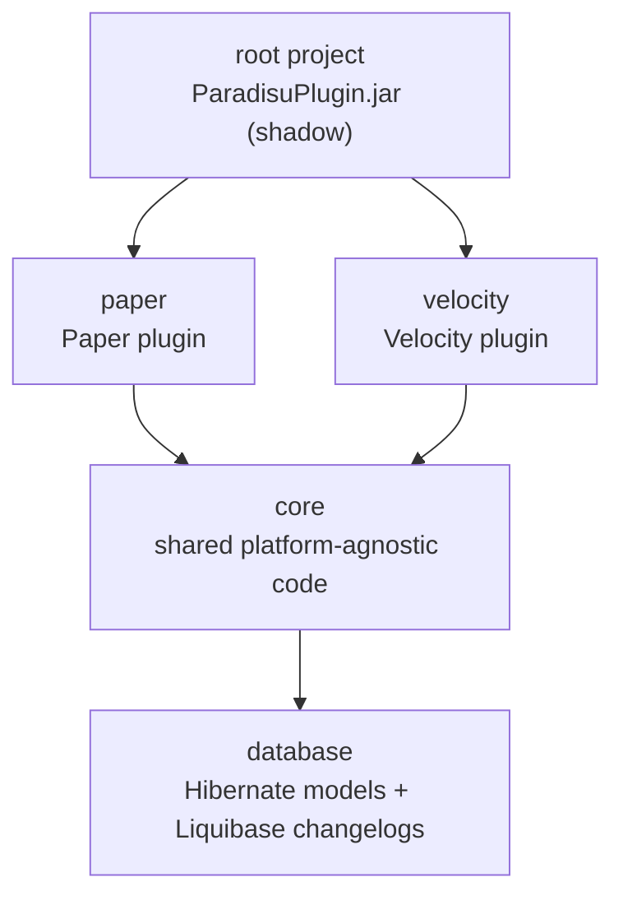
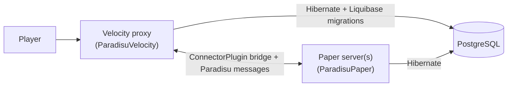
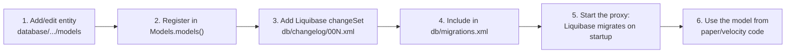
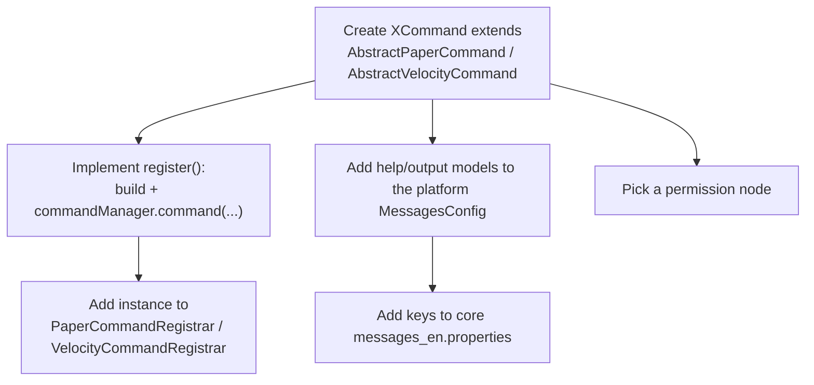
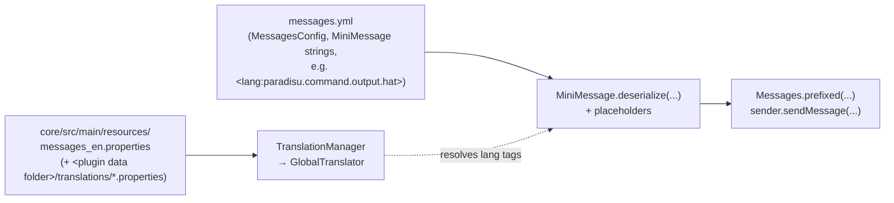
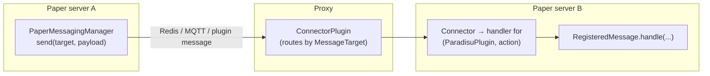
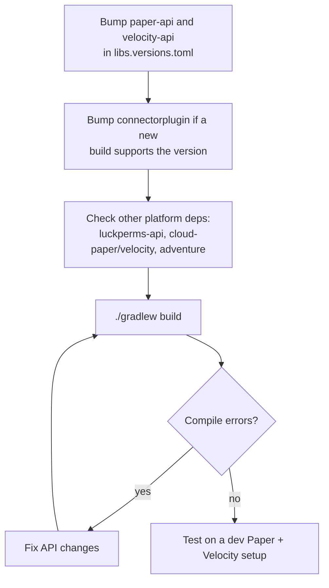

# Contributing to ParadisuPlugin

Thanks for helping out! This guide covers how the project is laid out and how to do the most common kinds of changes.

- [Project structure](#project-structure)
- [Compiling](#compiling)
- [Formatting (Spotless)](#formatting-spotless)
- [Database changes](#database-changes)
- [Adding commands](#adding-commands)
- [Sending messages and text](#sending-messages-and-text)
- [Cross-server messaging](#cross-server-messaging)
- [Reusable utilities](#reusable-utilities)
- [Updating dependencies](#updating-dependencies)

## Project structure

The build is a multi-module Gradle project (Kotlin DSL). The root project shades `paper` and `velocity` (and transitively `core` and `database`) into one `ParadisuPlugin.jar`.



| Module | Contents |
| --- | --- |
| `database` | Hibernate/JPA entities (`models/`), the `Models` registry, and Liquibase changelogs (`src/main/resources/db/`). No platform code. |
| `core` | Code shared by both platforms: the `ParadisuPlugin` interface, `DatabaseSession`, config loading (`ConfigManager`, `ConfigEntry`), `TranslationManager` and `Messages`, `HelpManager`, `PackManager`, the `messaging/` base classes, and utilities. Also holds the default language file `messages_en.properties`. |
| `paper` | `ParadisuPaper`, Paper commands/parsers/listeners, `sync/` (async DB work), `warps/` (`WarpManager`), `messaging/` (`PaperMessagingManager`, heartbeat/cluster state, message classes), `config/configs/` (`paradisu.yml`, `messages.yml` models), `plugin.yml`. |
| `velocity` | `ParadisuVelocity` (also runs Liquibase), Velocity commands/listeners, teleport utilities, `messaging/` (`VelocityMessagingManager`), config models, `velocity-plugin.json`. |
| `build-logic` | Included build with convention plugins (`net.paradisu.java-conventions`, `platform-conventions`, `shadow-conventions`): repositories, Java toolchain, Spotless, `processResources` templating. |

Dependencies are declared per module in each `build.gradle.kts` using the version catalog [gradle/libs.versions.toml](gradle/libs.versions.toml). `core` uses `compileOnly` for most libraries; the platform modules decide what is bundled.

### Runtime layout



The proxy owns schema migrations; Paper servers only read and write.

## Compiling

Requirements: **JDK 25** (the Gradle toolchain also resolves it automatically through the foojay plugin) and Git. A [devcontainer](.devcontainer/devcontainer.json) with Java 25 is provided.

```bash
./gradlew build           # compile, spotlessCheck, and build build/libs/ParadisuPlugin.jar
./gradlew shadowJar       # just build the jar
./gradlew :velocity:compileJava   # compile a single module
```

Notes:
- The final jar is `build/libs/ParadisuPlugin.jar`. Per-module jars are in each module's `build/libs/`.
- Lombok is used throughout (annotation processing is already configured).
- `plugin.yml`, `velocity-plugin.json` and `*.properties` are passed through Gradle `expand(...)`, so `${version}`, `${name}`, etc. are substituted at build time. A literal `$` in a `.properties` file must be escaped as `\$`.
- Version, id, authors and URL come from [gradle.properties](gradle.properties).

CI (`.github/workflows`) builds on every push. Pull requests run `spotlessApply` and push a formatting commit, then run `./gradlew build`.

## Formatting (Spotless)

Formatting is enforced with [Spotless](https://github.com/diffplug/spotless): Palantir Java Format (with Javadoc formatting), import ordering, unused import removal, and the AGPL license header (from `build-logic/src/main/resources/licenseHeaderFile`) on every Java file.

```bash
./gradlew spotlessApply   # fix formatting
./gradlew spotlessCheck   # verify (also runs as part of ./gradlew build)
```

Run `spotlessApply` before committing. `build` fails on unformatted code. New Java files only need the `package` line; Spotless adds the header.

## Database changes

Persistence uses **Hibernate (JPA)** on **PostgreSQL** with **HikariCP** pooling. The schema is managed by **Liquibase**, not by Hibernate: Hibernate does not create or alter tables, so every model change needs a matching changelog entry.



### 1. Liquibase schemas

Files live in `database/src/main/resources/db/`:

- `migrations.xml` is the root changelog loaded by Velocity. It defines DB-specific properties (`blob_type`, `timestamp_type`) and `<include>`s each changelog in order.
- `changelog/00N.xml` hold the changeSets.

Rules:
- **Never edit a changeSet that has been merged or released.** Liquibase checksums them; changing one breaks existing databases. Add a new changeSet instead.
- For a new change, create the next file (e.g. `004.xml`) and add `<include file="db/changelog/002.xml" />` after the existing include in `migrations.xml`. Continue the numeric changeSet `id`s and use `author="paradisu"`, as in `001.xml`.
- Prefer Liquibase change types (`createTable`, `addColumn`, `createIndex`, ...) over raw SQL so it stays portable. Provide a sensible `defaultValue`/`nullable` when adding columns to tables that already hold data.
- Table names are upper snake case (`PLAYERS`, `PLAYER_SERVER_SESSIONS`); column names are lower snake case. Foreign keys are named `fk_<table>_<ref>` and join columns `id_<entity>`.
- Migrations run only when the **proxy** starts (`ParadisuVelocity`), before players can connect. Deploy the proxy before Paper servers that depend on the new schema.

Example:

```xml
<databaseChangeLog ...>
    <changeSet id="8" author="paradisu">
        <addColumn tableName="WARPS">
            <column name="created" type="TIMESTAMP" />
        </addColumn>
    </changeSet>
</databaseChangeLog>
```

### 2. Database module (Hibernate models)

Entities live in `database/src/main/java/net/paradisu/database/models/` (grouped by area, e.g. `playerdata/`). Follow the existing models:

```java
@Accessors(fluent = true)
@Getter
@Entity
@Builder(toBuilder = true)
@AllArgsConstructor
@NoArgsConstructor
@Table(name = "WARPS")
public class WarpModel {
    @Id
    @GeneratedValue
    @Column(name = "id", nullable = false, updatable = false)
    private UUID id;
    ...
}
```

- Use Jakarta Persistence annotations (`jakarta.persistence.*`).
- Lombok: fluent accessors (`model.name()`), `@Getter`, `@Builder(toBuilder = true)`, `@AllArgsConstructor` and a `@NoArgsConstructor` (required by Hibernate). Add `@Setter` only to fields that should be mutable.
- `@Table` and `@Column` names must match the Liquibase schema exactly.
- Relations use `FetchType.LAZY`. Parents cascade to children (`cascade = ALL, orphanRemoval = true`) with `mappedBy` on the owning side.
- **Register every new entity** in [Models.java](database/src/main/java/net/paradisu/database/Models.java); `DatabaseSession` only maps classes listed there.
- This module must stay platform-independent: no Paper, Velocity or `core` imports.

### 3. Querying, persistence and best practices

Get the factory from the plugin (`paradisu.databaseSession().factory()`) and create a short-lived `EntityManager` per unit of work. See [PlayerJoinSync](paper/src/main/java/net/paradisu/paper/sync/PlayerJoinSync.java) and [PlayerQuitSync](paper/src/main/java/net/paradisu/paper/sync/PlayerQuitSync.java) for working examples.

```java
try (EntityManager em = paradisu.databaseSession().factory().createEntityManager()) {
    em.getTransaction().begin();
    PlayerModel player = em.find(PlayerModel.class, uuid);
    player.lastSeen(Instant.now());          // managed entity: change is flushed on commit
    em.getTransaction().commit();
} catch (Exception e) {
    paradisu.logger().error("Failed to update player", e);
}
```

Guidelines:
- **Never block the main thread.** On Paper, run database work asynchronously (`Bukkit.getScheduler().runTaskAsynchronously(...)`; see `PlayerJoinListener`) and hop back with `Bukkit.getScheduler().runTask(...)` to touch Bukkit/world/inventory APIs. On Velocity, do not do heavy work directly in command handlers; use Velocity's scheduler or event executors, and compose bridge calls with `CompletableFuture`s.
- **Capture data on the main thread, persist off-thread.** Read and serialize Bukkit objects (inventories, locations) before scheduling the async task, and pass plain values/byte arrays into it, as `PlayerQuitSync` does. Never hand live Bukkit objects to another thread.
- Use try-with-resources for the `EntityManager`; it is cheap to create and not thread-safe, so never share one between threads or keep one as a field.
- Wrap writes in an explicit transaction and always handle failure (log it, and decide whether to retry, abort or kick the player as appropriate).
- Use parameterized JPQL (`setParameter`) with typed queries; never concatenate user input. Use `setMaxResults` for "latest row" style queries and index columns you filter on (add the index in Liquibase).
- Do not touch lazy collections after the `EntityManager` is closed. Query what you need inside the session or copy it into plain values first.
- Check `databaseSession().open()` before relying on the database; startup logs a severe error if the connection failed.
- Keep transactions short and do not perform network or Bukkit calls while one is open.

## Adding commands

Commands use [Cloud](https://github.com/Incendo/cloud) v2 (`PaperCommandManager` on Paper, `VelocityCommandManager` on Velocity). Pick the platform that makes sense: network-wide or cross-server commands belong on Velocity (using the ConnectorPlugin bridge for server/world actions); commands that need Bukkit APIs belong on Paper.



Steps:

1. **Create the class** in `paper/.../commands/command/` or `velocity/.../commands/command/`, extending `AbstractPaperCommand` or `AbstractVelocityCommand` (which provide `paradisu`, `commandManager`, `helpManager`).
2. **Implement `register()`**, then register the built command:

   ```java
   @Override
   public void register() {
       var builder = this.commandManager
               .commandBuilder("hat")
               .permission("paradisu.hat")   // Paper nodes: paradisu.*, Velocity nodes: vparadisu.*
               .commandDescription(Description.of(
                       paradisu.messagesConfig().commands().hat().helpMsg()))
               .handler(this::hatCommand);
       this.commandManager.command(builder);
   }
   ```

   Add arguments with `.required(...)` / `.optional(...)` and a parser (e.g. `PlayerParser.playerParser()` on Velocity), and give each a `Description` from the config's `helpArgs`. See [BackCommand](velocity/src/main/java/net/paradisu/velocity/commands/command/BackCommand.java) for a full example, including aliases and optional arguments.
3. **Write the handler** `private void xCommand(CommandContext<S> context)`. Read arguments with `context.get("name")` / `context.getOrDefault(...)`. Keep it non-blocking (see [best practices](#3-querying-persistence-and-best-practices)).
4. **Register it** by adding `new XCommand(paradisu)` to `PaperCommandRegistrar.registerCommands` or `VelocityCommandRegistrar.registerCommands`. Commands not listed there are never registered.
5. **Add messages** (help text, argument help, output) as described in [Sending messages and text](#sending-messages-and-text).
6. For subcommands (e.g. `/paradisu reload`), see `ParadisuCommand` / `VParadisuCommand`.

## Sending messages and text

Player-facing text is never hard-coded. It flows from a language file, through a configurable message template, to an [Adventure](https://docs.advntr.dev/) `Component`.



### Adventure

- Use Adventure `Component`s everywhere; never legacy `§`/`&` color codes.
- Templates are [MiniMessage](https://docs.advntr.dev/minimessage/index.html) strings. Insert dynamic values with placeholders, not string concatenation:

  ```java
  MiniMessage.miniMessage().deserialize(
          template,
          Placeholder.component("player", Component.text(player.getUsername())));
  ```
- Wrap user-facing replies with `Messages.prefixed(component)` to prepend the standard Paradisu prefix.
- `<lang:key>` in a MiniMessage string is resolved by Adventure's `GlobalTranslator`, which `TranslationManager` populates, using the viewer's locale.

### Properly adding language strings

Keys live in [messages_en.properties](core/src/main/resources/messages_en.properties) (the default/fallback locale). Follow the naming scheme:

| Purpose | Key pattern |
| --- | --- |
| Command description | `paradisu.command.help.<command>` |
| Subcommand description | `paradisu.command.help.<command>.<sub>` |
| Argument description (by position) | `paradisu.command.help.<command>.<n>` |
| Command output | `paradisu.command.output.<command>` or `...<command>.<n>` for several variants |
| Shared / general text | `paradisu.general.*`, `paradisu.ranks.*` |

Rules:
- Values use `java.text.MessageFormat`: placeholders are `{0}`, `{1}`, and **a literal apostrophe must be doubled** (`player''s`). Do not use MiniMessage in the properties file for per-call values; keep it as plain text with `{n}` arguments, and pass arguments from the template, where MiniMessage placeholders can be nested (e.g. `<lang:paradisu.command.output.back.0:'<gold><player>'>`, with `<player>` supplied via `Placeholder.component("player", ...)` in code).
- Keep each command's keys grouped together, help keys first, then output keys, matching the existing order.
- `${...}` is substituted by Gradle at build time (e.g. `${version}`); escape a literal `$` as `\$`.
- Server owners can override or add translations by dropping `<locale>.properties` files (e.g. `en_US.properties`) into the plugin's `translations/` folder. Custom files load before the bundled ones. To ship a new bundled locale, add `messages_<locale>.properties` and list the locale in `TranslationManager.BUNDLED_LOCALES`.
- Do not remove or rename existing keys without updating every reference in `MessagesConfig` classes.

### Message configuration

Admins customize messages in `messages.yml`, backed by a Configurate `@ConfigSerializable` class: `paper/.../config/configs/MessagesConfig.java` and `velocity/.../config/configs/MessagesConfig.java`. Each command gets a nested class whose **default values reference the language keys**:

```java
@Getter
@ConfigSerializable
public static final class Hat {
    @Setting("help-msg")
    private String helpMsg = "<lang:paradisu.command.help.hat>";

    @Setting("output")
    private List<String> output = List.of("<lang:paradisu.command.output.hat>");
}
```

Then add the nested class as a field of `Commands` (`private Hat hat = new Hat();`). Conventions:
- Kebab-case `@Setting` names; use `@Comment` to document non-obvious options.
- `help-msg` is the command description, `help-args` lists argument descriptions in order, `output` is a list of message variants indexed in code (`output().get(0)`) in the same order as the `...output.<command>.<n>` keys.
- Because the config exposes these strings, handlers should read them from `paradisu.messagesConfig()` rather than from the translator directly.
- Config files are registered in `PaperConfigManager` / `VelocityConfigManager` (`paradisu.yml`, `messages.yml`). To add a new config file, create the `@ConfigSerializable` class and register a `ConfigEntry` there. Configs are reloaded by `/paradisu reload` and `/vparadisu reload`.

## Cross-server messaging

Paradisu sends its own messages between servers and proxies on top of [ConnectorPlugin](https://github.com/Phoenix616/ConnectorPlugin). Use it when one server has to tell others something (e.g. "warps changed") or share state (e.g. which players are online where). For player movement and remote commands, use ConnectorPlugin's bridge directly (`paradisu.connector().getBridge()`).



### Pieces

| Class | Module | Role |
| --- | --- | --- |
| `MessagingManager` | `core` | Base class. Registers handlers and sends data under the plugin's own name (`Constants.Plugin.NAME`), so Paradisu actions never collide with ConnectorPlugin's own. Catches and logs handler exceptions. |
| `RegisteredMessage` | `core` | Handler for one action: `handle(receiver, Message)`. Its nested `SerialMessage` interface is the outgoing payload (`action()` + `serialize()`, which returns an empty array by default). |
| `PaperMessagingManager` | `paper` | Registers the Paper messages, runs the heartbeat, and holds the cluster state (`clusterState()`, `liveServers()`, `findPlayer(...)`, `findServerForContext(...)`). |
| `VelocityMessagingManager` | `velocity` | Registers the proxy's messages (none yet). |

Existing messages (`paper/.../messaging/messages/`):

| Action | Target | Payload | Effect |
| --- | --- | --- | --- |
| `SERVER_HEARTBEAT` | `OTHERS_WITH_PLAYERS`, every 5 s and on shutdown | warp context, closing flag, online players | Updates (or removes) the sender in `clusterState`. Servers that have not sent a heartbeat for 15 s are ignored and pruned. |
| `SYNC_WARPS` | `OTHERS_QUEUE`, after any warp change | none | The receiver reloads warps from the database. The sending server reloads itself directly. |

### Adding a message

1. Create `FooMessage extends RegisteredMessage<BukkitConnectorPlugin, Player>` in `paper/.../messaging/messages/` (or the Velocity equivalent with `VelocityConnectorPlugin` and the Velocity `Player`). Give it a unique `public static final String ACTION`.
2. Add a nested `record Payload(...) implements SerialMessage` with `serialize()` and a `static Payload deserialize(byte[])`. Write and read fields in the same order with Guava's `ByteStreams.newDataOutput()` / `newDataInput(...)`. Never return `null` from `serialize()`.
3. Implement `handle(receiver, message)`: deserialize `message.getData()`; the sender is `message.getSendingServer()`, so it does not need to be in the payload. `receiver` may be null.
4. Register it in `registerMessages()` of `PaperMessagingManager` / `VelocityMessagingManager`. Unregistered actions are dropped silently by ConnectorPlugin.
5. Send it with `paradisu.messagingManager().send(MessageTarget.X, new FooMessage.Payload(...))`, or `send(MessageTarget.SERVER, "server:<name>", payload)` for one server.

```java
public class FooMessage extends RegisteredMessage<BukkitConnectorPlugin, Player> {
    public static final String ACTION = "FOO";
    private final ParadisuPaper paradisu;

    public FooMessage(ParadisuPaper paradisu) {
        super(ACTION);
        this.paradisu = paradisu;
    }

    @Override
    public void handle(Player receiver, Message message) {
        Payload payload = Payload.deserialize(message.getData());
        // ...
    }

    public record Payload(String value) implements SerialMessage {
        @Override
        public String action() {
            return ACTION;
        }

        @Override
        public byte[] serialize() {
            ByteArrayDataOutput out = ByteStreams.newDataOutput();
            out.writeUTF(this.value);
            return out.toByteArray();
        }

        public static Payload deserialize(byte[] data) {
            return new Payload(ByteStreams.newDataInput(data).readUTF());
        }
    }
}
```

### Rules

- **Threading.** On Paper, ConnectorPlugin runs handlers on the main thread. Keep them fast and never do database work in them; schedule it asynchronously, as `SyncWarpsMessage` does via `WarpManager.syncWarps()`. **Send from the main thread** on Paper: the plugin message messenger is not thread-safe, so from an async task hop back with `Bukkit.getScheduler().runTask(...)` first. On Velocity, handlers run on a connector thread.
- **Do not extend or create ConnectorPlugin's `Bridge`.** A second `Bridge` re-registers ConnectorPlugin's built-in handlers and listeners and breaks its teleports and responses. Use `paradisu.connector().getBridge()`.
- **Choose the target deliberately.** `*_QUEUE` targets are held by the plugin message messenger until a player is on the server, so use them only for messages that are still valid late (like `SYNC_WARPS`). Use `*_WITH_PLAYERS` for periodic or time-sensitive state (like heartbeats). `OTHERS_*` skips the sending server, so apply the change locally yourself.
- **Payload changes are protocol changes.** Every server must run the same plugin version, since there is no versioning inside payloads. To change a payload incompatibly, add a new action rather than changing the old one.
- Cluster state comes from heartbeats, so it lags by up to 5 s and only covers servers that sent one in the last 15 s. With the plugin message messenger, empty servers cannot send, so they do not appear. Code that uses `clusterState()` must handle a server or player being missing.

## Reusable utilities

`core/src/main/java/net/paradisu/core/utils/` has platform-independent helpers. Prefer them over writing new versions:

- **`ExponentialBackoffLimiter<K>`**: per-key rate limiting. A token bucket (`burst`, `refillInterval`) allows short bursts; an attempt with no tokens left is a strike that locks the key out for `baseTimeout * 2^strikes` (capped at `maxTimeout`). Strikes are forgiven one per `strikeDecay`. It is thread-safe and drops idle keys by itself. Check it **before** doing the expensive part of a command (as `/warp` does before matching names), make the settings configurable, and offer a bypass permission:

  ```java
  ExponentialBackoffLimiter.Result result = limiter.tryAcquire(player.getUniqueId());
  if (!result.allowed()) {
      // tell the player to retry in result.retryAfterSeconds() seconds
      return;
  }
  ```
- **`FuzzyMatcher<T>`**: an immutable index for "closest name" lookups. Build it once when the data changes (`FuzzyMatcher.builder().add(name, value).add(alias, value, true).build()`), and look up with `match(input, filter, tieBreaker)`. Check for an exact match with a map first. Lookups cost little and are bounded (input up to 64 characters, edit distance up to 3), but they are still linear in the number of keys, so run them after the rate limit check, not in a suggestion provider.

## Updating dependencies

All versions are centralized in [gradle/libs.versions.toml](gradle/libs.versions.toml): `[versions]`, `[libraries]`, `[bundles]` and `[plugins]`. Change the version in `[versions]`; do not hard-code versions in module build files. Two exceptions live in `build-logic`: the Java toolchain version (`java-conventions` and `build-logic/build.gradle.kts`) and the Palantir Java Format version (`java-conventions`).

### New Minecraft versions



1. Update `paper-api` (e.g. `26.3.build.157-beta`). The Paper `api-version` in `plugin.yml` is derived from it automatically by `parseApiVersion`, which keeps the leading `major.minor[.patch]`.
2. Update `velocity-api`. Velocity is on snapshot builds; use the latest `-SNAPSHOT` timestamped version that matches the proxy you run.
3. Check that `cloud-paper`/`cloud-velocity`, `connectorplugin` and `luckperms-api` support the new version (see release notes) and bump them if needed.
4. If the new Minecraft version needs a newer JDK, update the toolchain in `build-logic/.../net.paradisu.java-conventions.gradle.kts`, `build-logic/build.gradle.kts`, the CI workflows (`java-version`) and the devcontainer.
5. Run `./gradlew build` and fix API breakages, then test on real servers.

### How to check for the latest version of a dependency

| Dependency | Where to look |
| --- | --- |
| Most libraries (Adventure, Cloud, Configurate, Hibernate, Liquibase, PostgreSQL, Guava, Lombok, Spotless...) | [Maven Central](https://central.sonatype.com/): search the `group:name`, or `https://repo.maven.apache.org/maven2/<group path>/<name>/maven-metadata.xml` |
| `paper-api` | `https://repo.papermc.io/service/rest/repository/browse/maven-public/io/papermc/paper/paper-api/`, or the [PaperMC downloads](https://papermc.io/downloads/paper) |
| `velocity-api` | `https://repo.papermc.io/service/rest/repository/browse/maven-public/com/velocitypowered/velocity-api/` (snapshots), or the [Velocity downloads](https://papermc.io/downloads/velocity) |
| `connectorplugin-*` | `https://repo.minebench.de/` (`de/themoep/connectorplugin/`); see also the [ConnectorPlugin repo](https://github.com/Phoenix616/ConnectorPlugin) |
| `fastutil-object-object-maps` | OpenCollab repo, `https://repo.opencollab.dev/main/` (`com/nukkitx/fastutil/`) |
| Gradle plugins (shadow, blossom, indra, lombok, spotless) | [Gradle Plugin Portal](https://plugins.gradle.org/) or Maven Central; the `[plugins]` entries use the plugin id |
| `luckperms-api` | [LuckPerms releases](https://github.com/LuckPerms/LuckPerms/releases) / Maven Central `net.luckperms:api` |

Repositories used by the build are declared in `net.paradisu.java-conventions.gradle.kts` (Maven Central, PaperMC, OpenCollab, Minebench). Fetch metadata directly, for example:

```bash
curl -s https://repo.maven.apache.org/maven2/org/hibernate/orm/hibernate-core/maven-metadata.xml | grep -E "<(latest|release)>"
curl -s https://repo.papermc.io/repository/maven-public/io/papermc/paper/paper-api/maven-metadata.xml | tail -20
```

Guidelines:
- Keep versions that share a project in sync via a shared `version.ref` (e.g. all Hibernate artifacts, both Adventure artifacts).
- Hibernate, Liquibase and PostgreSQL are upgraded together; review release notes and test migrations on a copy of the database.
- Prefer stable releases over betas, except where the project already tracks a snapshot/beta (Paper, Velocity, ConnectorPlugin).
- After updating, run `./gradlew build` and test on a Velocity + Paper setup before opening a pull request.

## Pull requests

- Branch from `master`, keep changes focused, and run `./gradlew spotlessApply build` before pushing.
- Describe what changed and how you tested it. Report security-sensitive issues privately to the developers rather than via public issues.
