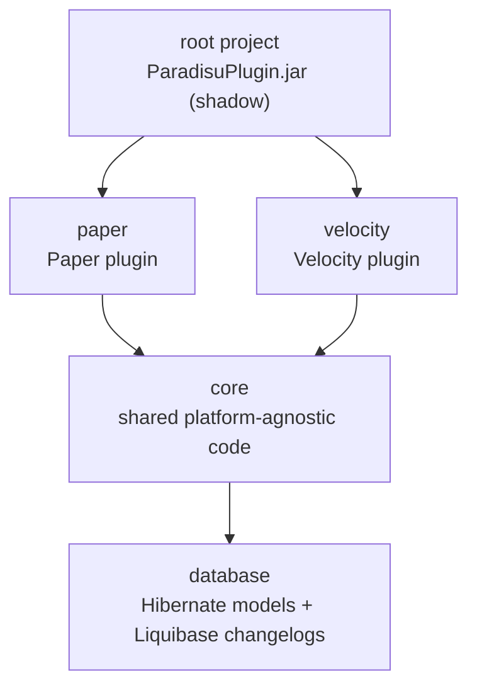
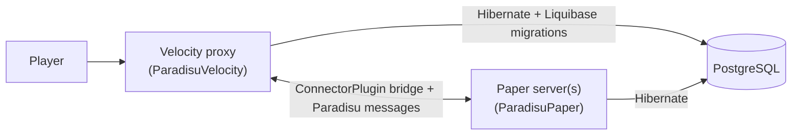
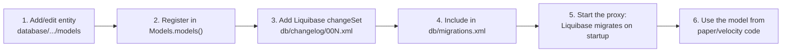
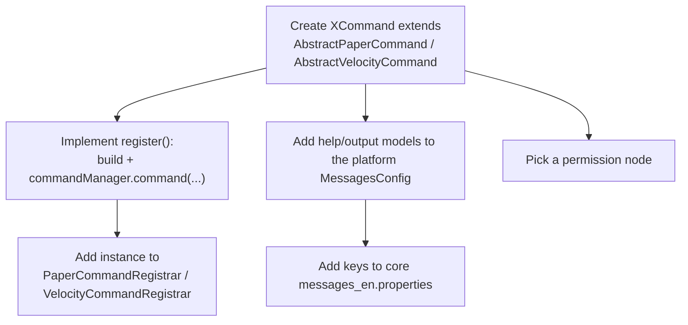
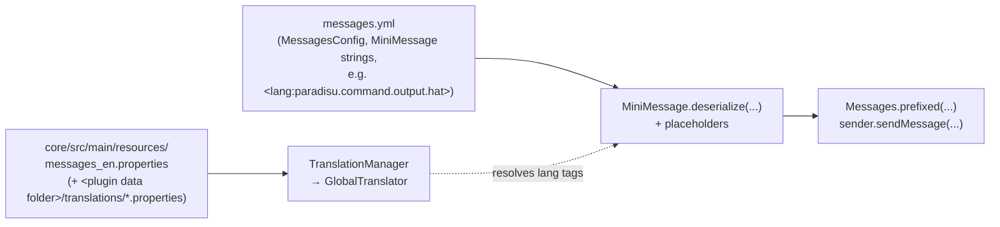
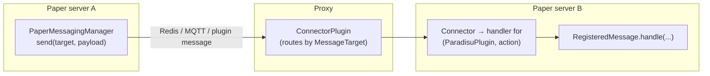
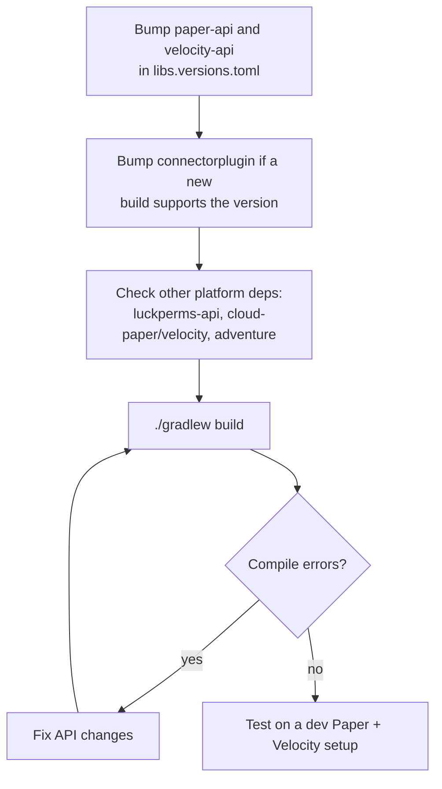

# Contributing to ParadisuPlugin

Thanks for helping out! This guide covers how the project is laid out and how to do the most common kinds of changes.

- [Project structure](#project-structure)
- [Compiling](#compiling)
- [Development Environment](#development-environment)
- [Formatting (Spotless)](#formatting-spotless)
- [Database changes](#database-changes)
- [Adding commands](#adding-commands)
- [Sending messages and text](#sending-messages-and-text)
- [Cross-server messaging](#cross-server-messaging)
- [Reusable utilities](#reusable-utilities)
- [Updating dependencies](#updating-dependencies)

## Project structure

The build is a multi-module Gradle project (Kotlin DSL). The root project shades `paper` and `velocity` (and transitively `core` and `database`) into one `ParadisuPlugin.jar`.



| Module | Contents |
| --- | --- |
| `database` | Hibernate/JPA entities (`models/`), the `Models` registry, and Liquibase changelogs (`src/main/resources/db/`). No platform code. |
| `core` | Code shared by both platforms: the `ParadisuPlugin` interface, `DatabaseSession`, config loading (`ConfigManager`, `ConfigEntry`), `TranslationManager` and `Messages`, `HelpManager`, `PackManager`, the `messaging/` base classes, and utilities. Also holds the default language file `messages_en.properties`. |
| `paper` | `ParadisuPaper`, Paper commands/parsers/listeners, `sync/` (async DB work), `warps/` (`WarpManager`), `messaging/` (`PaperMessagingManager`, heartbeat/cluster state, message classes), `config/configs/` (`paradisu.yml`, `messages.yml` models), `plugin.yml`. |
| `velocity` | `ParadisuVelocity` (also runs Liquibase), Velocity commands/listeners, teleport utilities, `messaging/` (`VelocityMessagingManager`), config models, `velocity-plugin.json`. |
| `devtools/migrate` | Dev-only Liquibase runner (`DevMigrate`) used by `dev db`; not part of `ParadisuPlugin.jar`. |
| `devtools/capture` | Dev-only packet capture plugin (`ParadisuCapture.jar`) for the `dev capture` commands. One jar loads on Paper, Velocity and Limbo; it is not part of `ParadisuPlugin.jar` and has no Paradisu dependencies. |
| `build-logic` | Included build with convention plugins (`net.paradisu.java-conventions`, `platform-conventions`, `shadow-conventions`): repositories, Java toolchain, Spotless, `processResources` templating. |

Dependencies are declared per module in each `build.gradle.kts` using the version catalog [gradle/libs.versions.toml](gradle/libs.versions.toml). `core` uses `compileOnly` for most libraries; the platform modules decide what is bundled.

### Runtime layout



The proxy owns schema migrations; Paper servers only read and write.

## Compiling

Requirements: **JDK 25** (the Gradle toolchain also resolves it automatically through the foojay plugin) and Git. A [devcontainer](#development-environment) with Java 25 is provided.

```bash
./gradlew build           # compile, spotlessCheck, and build build/libs/ParadisuPlugin.jar
./gradlew shadowJar       # just build the jar
./gradlew :velocity:compileJava   # compile a single module
```

Notes:
- The final jar is `build/libs/ParadisuPlugin.jar`. Per-module jars are in each module's `build/libs/`.
- Lombok is used throughout (annotation processing is already configured).
- `plugin.yml`, `velocity-plugin.json` and `*.properties` are passed through Gradle `expand(...)`, so `${version}`, `${name}`, etc. are substituted at build time. A literal `$` in a `.properties` file must be escaped as `\$`.
- Version, id, authors and URL come from [gradle.properties](gradle.properties).

CI (`.github/workflows`) builds on every push. Pull requests run `spotlessApply` and push a formatting commit, then run `./gradlew build`.

## Development environment

The devcontainer gives you a complete, runnable network: a Velocity proxy and one or more Paper backends running your working copy of the plugin, PostgreSQL 17 with sample data, and Redis for ConnectorPlugin.

In this section: 
- [Getting started](#getting-started)
- [The `dev` command](#the-dev-command)
- [Joining from outside](#joining-from-outside)
- [Debugging and hot reload](#debugging-and-hot-reload) 
- [Database and migration testing](#database-and-migration-testing)
- [Consoles, zellij and web access](#consoles-zellij-and-web-access)
- [Sharing over the internet (`dev share`)](#sharing-over-the-internet-dev-share)
- [Packet capture (`dev capture`)](#packet-capture-dev-capture) 
- [Minecraft data](#minecraft-data-fixtures-lookup-and-decoding) 
- [Sharing a setup (profiles)](#sharing-a-setup-profiles) 
- [The published image](#the-published-image) 
- [Troubleshooting](#troubleshooting).

### Getting started

1. Open the repository in VS Code and choose **Reopen in Container**. Two configurations are offered: *Paradisu (prebuilt image)* pulls the image published by CI (fast, default); *Paradisu (build locally)* builds [.devcontainer/Dockerfile](.devcontainer/Dockerfile), which you want when editing the image.
2. Wait for `dev bootstrap` (runs automatically) to build the jar, download the servers and plugins and seed the database. If it prints warnings (for example no network), fix the cause and run `dev bootstrap` again.
The container installs the *pre-release* channel of the Red Hat Java and Gradle extensions (`@prerelease` in `devcontainer.json`), because Lombok support needs it, and the PostgreSQL extension finds two ready-made connections (`Paradisu Dev`, `LuckPerms Dev`) in the workspace settings, [.vscode/settings.json](.vscode/settings.json). They use the extension's "No Password" login with SSL off: the dev database trusts connections on the compose network (`.devcontainer/postgres/pg_hba.conf`; its port is not published), so no password is stored in the editor's credential store or prompted for. Outside the container, switch those two Java extensions to their pre-release versions yourself. If you created connections by hand earlier (they land in your *User* settings by default), delete them to avoid duplicates.
3. Create `dev/dev.local.toml` (see [dev.local.toml.example](dev/dev.local.toml.example)) with `accept_eula = true`.
4. Run `dev start`, then join `localhost:25565`. Online mode is on by default, so use a licensed account; set `online_mode = false` in `dev.local.toml` to let any username join.

> The GHCR package must be public for the prebuilt image to be pulled without logging in. A repository admin sets this once, after the first successful run of the *Devcontainer* workflow (Package settings, Change visibility).

### The `dev` command

Run `dev` with no arguments for a menu, or a group name (`dev capture`, `dev db`, `dev share`, `dev mc`, `dev profile`, `dev web`) for the menu of that group. Missing arguments are asked for on a terminal (pick an instance, a changelog, a snapshot, a player, a capture, a filter, …); with arguments, or with `--no-input` (also: no terminal, `CI` set, `PARADISU_DEV_NO_INPUT=1`), it never prompts, and a destructive command without `--yes` refuses instead of waiting for an answer. `dev help` lists the commands by section, `dev help <group>` one group (`dev help capture`), and `dev help <command>` (or `dev <command> --help`) the options of one command.

#### Output style

Everything `dev` prints goes through [output.ts](dev/src/output.ts) so that menus and tables look the same everywhere:

1. Tabular data uses `table()` (header row), `columns()` (menu labels), `keyValue()` (label/value blocks) or `streamRow()` (lines that arrive one at a time). Never align with `padEnd`/`padStart`; they break on colors and wide names.
2. Table headers are written lower case in code and shown UPPERCASE, columns are separated by two spaces and numbers are right-aligned. An empty result is one plain sentence (`No captures.`), never an empty table.
3. Color is minimal and never the only signal: bold for headings and table headers, dim for secondary text (hints, `Same as:`), green/yellow/red only for status words (`status()`) and the `warning:`/`error:` prefixes. It switches off for pipes, `NO_COLOR` and `TERM=dumb`.
4. Status words are lower case: `running`, `stopped`, `disabled`, `starting`, `ok`, `failed`, `missing`, `stale`, `live`, `off`.
5. Command summaries are at most 60 characters, imperative, without parentheticals. Put flags in `options` (one line each) and detail in `details`; `usage` holds positional arguments only.
6. Print only what the user cannot already know: the result (a new path or id) and problems. Never echo what they just chose, counts they just saw in a picker, how-to-use hints or reminders after success, or details of work that is expected to just work. A warning is the problem, a semicolon and the fix. `next(...)` is only for the fix to a problem, never a tour of follow-up commands.
7. Show paths repo-relative (`relPath()`), sizes with `formatBytes()` and durations with `formatDuration()`.
8. Machine-readable output (`--format json|snbt|raw`, `mc encode`) stays unstyled.

```ts
log(table(['id', { header: 'size', align: 'right' }], rows));
next('dev capture show latest');
```

| Command | What it does |
| --- | --- |
| `dev setup [--refresh]` | Resolve versions and download Purpur, Velocity and plugins into `dev/.cache` |
| `dev start [names] [--ui]` / `stop` / `restart` | Build the jar, deploy it to every instance, apply preset configs and run them under the console supervisor (`--ui` then opens the consoles) |
| `dev status` | Running state, pids and ports |
| `dev console <name> [--read-only] [--wait]` | Attach to a console; Ctrl-C detaches and the server keeps running |
| `dev logs <name> [-f] [--console]` | The server's log (`--console`: the raw console output) |
| `dev ui [layout\|kill] [--background]` | Open the zellij workspace of live consoles |
| `dev web start\|stop\|status\|token` | Serve that workspace to a browser |
| `dev share start\|stop\|status\|logs\|providers` | Public tunnels for the proxy, Limbo and web console (Pinggy by default); [reference](#sharing-over-the-internet-dev-share) |
| `dev capture start\|stop\|status\|watch` | Record the network's packets, or follow them live ([reference](#packet-capture-dev-capture)) |
| `dev capture list\|show\|packet\|export\|rm` | Browse, dump, export and delete recorded captures |
| `dev capture formats\|protocol\|doctor` | Export formats, the packet name tables, and a health check of the capture plugin |
| `dev reset-world <name>` / `dev clean` | Delete worlds / all runtime data |
| `dev db reset [--through 00N] [--all]` | Rebuild the database up to a changelog with seed data and fixtures (`--all` also resets LuckPerms) |
| `dev db seed` | Reseed at the current changelog position |
| `dev db snapshot <n>` / `restore <n>` | Save and restore the database |
| `dev db fixtures [load\|list] [files] [--replace]` | Load Minecraft data fixtures (inventories) |
| `dev db psql [args]` | Open psql |
| `dev mc players\|inventory\|dump\|nbt\|item\|encode\|uuid\|columns` | Look up, decode and encode Minecraft data (below) |
| `dev override <instance> <path>` | Keep a changed runtime config file across starts and in profiles |
| `dev profile export\|import\|inspect\|list` | Share a whole dev setup (below) |

The network is defined in [dev/dev.toml](dev/dev.toml): the Minecraft and Velocity versions default to `auto` and follow `gradle/libs.versions.toml`, so bumping `paper-api` updates the dev network too. Backends run Purpur (a Paper fork, as in production) at the newest build for that Minecraft version. Override anything in the gitignored `dev/dev.local.toml`; `[[servers]]` and `[[plugins]]` entries merge by `name`/`key`. The tool is TypeScript run directly by Node 24; `pnpm --dir dev typecheck` checks it and `pnpm --dir dev test` runs the codec tests (NBT, SNBT, Paper item blobs, UUIDs).

- **Add a backend server:** add a `[[servers]]` entry (unique ports) with `enabled = true` and, to attach the debugger, a matching configuration in `.vscode/launch.json`. Servers share the proxy, database and Redis; `context` sets the session, warp and inventory contexts.
- **Add a plugin:** add a `[[plugins]]` entry with `source = "modrinth"` (and `slug`), `"url"`, `"jenkins"` (`job_url` of a Jenkins job; its latest successful build is used, `artifact_pattern` picks the jar), `"github"` (`repo = "owner/name"`; the latest release's jar, `asset_pattern` picks the asset; set `GITHUB_TOKEN` to avoid the anonymous API rate limit) or `"local"`. `platforms` may include `"limbo"` for plugins that run on the Limbo server. Modrinth plugins are resolved for the current game version; use `allow_prerelease` or `game_version_fallback` when only betas or older tags exist.
- **Preset a plugin's config:** put files in `dev/templates/plugins/<key>/<paper|velocity>/`. They are copied into the plugin's data folder (`config_dir` in `dev.toml` when the folder name differs from the key) on every start, overwriting what is there. `${NAME}` placeholders are filled from [templates.ts](dev/src/templates.ts). Generate the real defaults by running the plugin once, then trim them down.
- **Limbo:** a standalone [Limbo](https://modrinth.com/mod/limbo-server) waiting-room server (`[limbo]` in `dev.toml`, enabled by default) runs next to the proxy with ConnectorPlugin and [LimboTransfer](https://github.com/Kas-tle/LimboTransfer). It is deliberately not in the proxy's server list: the Paradisu proxy config's `limbo-server` section points at it, so `/vparadisu maintenance` transfers players there. When the proxy starts, `LimboListener` has Limbo (addressed as `limbo` over ConnectorPlugin and Redis) run `transferall` back to `transfer-return-target`, so restarting the proxy with `dev restart proxy` returns players from Limbo. Limbo is built for one Minecraft version per release and starts first so it is subscribed before the proxy speaks. Set `limbo.enabled = false` if no Limbo build exists yet for the Minecraft version in use.
- **World presets:** `world_preset` is `redstone_ready` (flat: bedrock, 3 stone, 116 sandstone), `void` or `default`.

Notes:
- ConnectorPlugin and TC Coasters are not on Modrinth; they are fetched from their CI servers. Plugins that depend on each other (TrainCarts needs BKCommonLib, TC Coasters needs both) must all be listed.
- Newer Minecraft versions enable the whitelist by default (empty, so nobody can join); the `server.properties` template turns it off. Add `white-list=true` to a server's own template under `dev/templates/servers/<name>/` if you want to test it.
- Each JVM runs under a small detached supervisor (`dev _supervise`, see below), not in a terminal: closing your terminal never stops a server, and `dev console` can be attached from any number of terminals.
- Paper rewrites its generated config files, but `dev/templates` always wins on the next start. Edit the templates, not the files in `dev/run`.

### Joining from outside

Compose publishes only the proxy port (`PARADISU_PROXY_PORT`, default 25565) and the Limbo port (`PARADISU_LIMBO_PORT`, default 30000) on all host interfaces, so other machines can join using the host's address. Backend and debug ports stay inside the container. Players are *transferred* to Limbo and back, so the addresses the proxy hands out must be reachable by them: set `public_host` in `dev/dev.local.toml` to your LAN or public address (default `localhost`), and `proxy.public_port` / `limbo.public_port` if you remapped a published port. On Windows with WSL2, forward the port from Windows to WSL (or use mirrored networking) and allow it through the firewall. In Codespaces or on a remote Docker host, forward port 25565 manually.

### Debugging and hot reload

Use **Run and Debug**, then **Debug network** (starts the network and attaches to the proxy and lobby; **Debug all** adds the creative server). The image uses JetBrains Runtime with `-XX:+AllowEnhancedClassRedefinition` and `java.debug.settings.hotCodeReplace` is `auto`: edit a method and save, and VS Code pushes the recompiled class into the running server. Enhanced redefinition also allows adding and removing methods and fields. Resource changes (`messages_en.properties`, `plugin.yml`) need `dev restart <name>`, as does anything the debugger refuses to redefine. Set `hotswap_agent = true` to additionally enable HotswapAgent. [hotswap.ts](dev/src/hotswap.ts) loads only the plugins the build needs (a dependency on `org.hibernate.orm` in `gradle/libs.versions.toml` enables HibernateJakarta, plus two JVM-level fixes) and none on Limbo; add more by name with `hotswap_plugins` in `[jvm]`. The attach configs in `.vscode/launch.json` need a `projectName` so the debugger knows which Gradle project to build on hot replace.

### Database and migration testing

Seed data lives in `dev/db/seed/<NNN>.sql`, one file per changelog, written against the schema as of that changelog (the deliberate NULLs in `002.sql` exist so that changelog 003 has something to backfill). `dev db reset` applies each changelog with Liquibase, loads its seed, and finally checks that no already-applied changeset would be re-run by the proxy.

To test a new changelog against realistic data:
1. `dev db reset --through <previous changelog>`
2. `dev start`: the proxy applies the new changelog on startup, exactly as in production.

When you add a changelog that changes data shape, add `dev/db/seed/<NNN>.sql` for the new columns or tables. Personal rows (for example your own UUID) go in the gitignored `dev/db/seed/local.sql`. Minecraft binary data (inventories) is not in the SQL seeds; see *Minecraft data* below.

### Consoles, zellij and web access

Every instance runs under a small detached supervisor (`dev _supervise <name>`, [supervisor.ts](dev/src/supervisor.ts)) that owns the JVM's stdin/stdout, writes `dev/run/<name>/.dev/console.log` and serves the console on a unix socket. `dev console <name>` is a client of that socket: it replays recent output, keeps a command history, and detaches on Ctrl-C or Ctrl-D without touching the server. Servers run with `-Dterminal.jline=false`, so there is no tab completion in the console. `--read-only` only watches, and `--wait` waits for the server (and reconnects after a restart), which is what the zellij panes use.

`dev ui` opens a [zellij](https://zellij.dev) workspace made only of such clients, so closing or killing it (`dev ui kill`) never affects the servers. The default layout `network` has a *consoles* tab (proxy and Limbo stacked, then one pane per enabled backend), a *db* tab (psql) and a *shell* tab; `tabs` has one tab per instance. Layouts are generated from the enabled instances. Add your own as `dev/layouts.local/<name>.kdl` (gitignored; [dev/layouts/backends.kdl](dev/layouts/backends.kdl) is an example), then `dev ui <name>`. Inside zellij, `dev ui <layout>` adds the layout as a tab. Detach with Ctrl-o d; Ctrl-q closes the workspace (the servers keep running), which is why `.vscode/settings.json` stops VS Code from taking Ctrl+Q for itself in the terminal. Set `ui.default_layout` / `ui.session` in `dev.toml`.

`dev web start` starts zellij's web client and creates the session in the background (`web_sharing "on"` in the generated config is what lets browsers attach; after changing it run `dev web stop`, `dev ui kill`, then `dev web start` since it needs a restart); open the printed URL and log in with a token (`dev web token`; `--read-only` tokens can only watch). It binds `127.0.0.1:8082` by default, which VS Code forwards from the container (`forwardPorts`). To expose it to the network set `web.bind = "0.0.0.0"` in `dev.local.toml`: zellij then requires TLS, so a self-signed certificate is generated into `dev/run/.zellij/tls` (browsers warn once), and the port must also be published in `docker-compose.yml` (a commented line is there). **Anyone with a normal token has a full shell in the container**; hand out read-only tokens and keep the default bind unless you need more.

### Sharing over the internet (`dev share`)

| Command | What it does |
| --- | --- |
| `dev share start [proxy] [limbo] [web]` | Open tunnels for the named targets and keep them renewed (default targets: `share.targets`; a checkbox menu on a terminal). `--provider <name>` picks the tunnel service, `--foreground` runs the daemon in this terminal instead of the background |
| `dev share status` | Tunnel addresses and when they renew |
| `dev share logs [-f]` | The daemon's log (`-f` follows it) |
| `dev share stop` | Close the tunnels and restore `public_host` |
| `dev share providers` | The available tunnel services |

`dev share start` opens public tunnels, so people outside your network can join without port forwarding. The proxy and Limbo are tunnelled over TCP and the zellij web console over HTTPS (it needs the default `web.bind = "127.0.0.1"`; the tunnel provides the TLS). Limbo is included because players are *transferred* to it and back by `/vparadisu maintenance`: the addresses in the proxy's `paradisu.yml` (`limbo-server`, `transfer-return-target`) must be reachable by them. While tunnels are live, `dev share` re-renders that file with the tunnel addresses and runs `vparadisu reload` on the proxy; `dev share stop` restores `public_host`.

The default provider is [Pinggy](https://pinggy.io) through its Node SDK (an optional dependency with a native addon, downloaded on `pnpm install`). Without an account its tunnels last **60 minutes** and get random addresses, so a background daemon (`dev share logs -f` follows it) renews them about 30 seconds early (`share.renew_before_seconds`), reopens tunnels that drop, and publishes the new addresses. **Each renewal changes the address and disconnects players who joined through it.** A Pinggy token (`[share.providers.pinggy] token` in `dev.local.toml`, or `PINGGY_TOKEN`) removes the limit and keeps the address stable. Never put the token in `dev.toml`; profiles never carry `share` settings.

By default the proxy tunnel sends the PROXY protocol (`share.proxy_protocol = "v2"`) and `velocity.toml` gets `haproxy-protocol = true` while sharing, so Velocity sees the players' real addresses (and its per-IP `login-ratelimit` works per player). The catch is that Velocity then refuses connections without the header, including your own `localhost:25565`: join through the tunnel address while sharing, or set `share.proxy_protocol = "off"` (then every remote player appears as 127.0.0.1 and shares one rate limit). Limbo's tunnel never sends the header. A normal web token is a shell in the container: share `web` with `dev web token --read-only` tokens only.

Other services plug in as providers: implement `ProviderFactory` (see the header of `dev/src/share/provider.ts`), import the service's SDK lazily, register it in `dev/src/share/providers/index.ts` and select it with `share.provider` or `dev share start --provider <name>`. `dev share providers` lists what is available.

### Packet capture (`dev capture`)

`dev capture` records the packets of the running dev network, for debugging protocol-level problems: forwarding between the proxy and a backend, transfers to Limbo, plugin messages, the configuration phase. It sees the decoded frames of **both** legs of the proxy (client to proxy, and proxy to each backend) and of every backend and Limbo, which an external MITM proxy such as SniffCraft cannot. Captures are compressed (gzip), live in `dev/captures/<id>/` (gitignored, not part of profiles) and can be read back with filters, exported for other tools, or followed live.

The recorder is a separate small plugin, `devtools/capture` (`ParadisuCapture.jar`), which `dev start` installs on the proxy, Limbo and every backend. While nothing is recorded it only follows each connection's login state; recording copies frames to a queue that a background thread compresses, and when that queue fills up packets are dropped and counted instead of slowing the server. Set `[capture] enabled = false` in `dev.local.toml` to leave it out (restart the instances after changing it).

#### Quick start

```bash
dev start
dev capture start                     # asks whose packets to record and when to stop
# ...join the network, do the thing you want to look at...
dev capture stop
dev capture show                      # pick the capture, optionally build a filter
dev capture export                    # pick the capture, the format and the instances
```

Without arguments on a terminal every command below asks for what it needs (a capture from a menu, a filter step by step, the export format). Each guided run prints the **equivalent command line** (`Same as: dev capture show 2026… --type play/move_* --dir cb`), so you can learn the options and script them. Passing any option of a step skips that step's questions, and `--no-input` never asks.

#### Commands

| Command | What it does |
| --- | --- |
| `dev capture start [options]` | Start recording on the running instances ([options](#recording-options)). Guided when given no recording options |
| `dev capture stop [--on names]` | Stop the recordings; prints packets, size and anything dropped |
| `dev capture status` | Plugin state, active recordings and live connections of every running instance |
| `dev capture watch [--on names] [filters] [--hex N]` | Follow packets live. Guided filter when given none. Ctrl-C ends; it does not stop a recording |
| `dev capture list` | All captures: id, instances, packets, size, why it stopped |
| `dev capture show [id] [--instance a,b] [filters] [--limit N] [--hex N] [--stats]` | Print a capture's packets, or with `--stats` counts and bytes per packet type and connection |
| `dev capture packet [id [seq]] [--instance x] [--raw file] [--no-id]` | Hex dump of one packet (the `#seq` from `show`); `--raw` writes its bytes to a file, `--no-id` leaves out the packet id |
| `dev capture export [id] [--format name] [--instance a,b] [--out dir] [filters] [--opt k=v]` | Convert a capture for another tool ([formats](#exporting)). Asks for the format when `--format` is missing |
| `dev capture formats` | The export formats |
| `dev capture rm [ids...] [--yes]` | Delete captures; a multi-select menu without ids, one confirmation for all |
| `dev capture protocol [--refresh]` | Generate or show the packet name table for the current Minecraft version |
| `dev capture doctor [instances...]` | Check that capture works: see [Troubleshooting](#troubleshooting-capture) |

A capture `id` is the full id, any unique prefix, or `latest`; without one, commands on a terminal show a menu (newest first), and `show` and `export` use `latest` when scripted.

#### Recording options

`dev capture start`:

| Option | Meaning |
| --- | --- |
| `--on <instances>` | Instances to record (comma separated or repeated). Default: all running ones, with a checkbox menu when there are several |
| `--player <name\|uuid>` | Only these players (repeatable or comma separated; names are case-insensitive). Default: everyone |
| `--next-join` | Wait for the next login that matches `--player` (anyone if none given) and record only that connection, from its handshake. Existing connections are ignored |
| `--duration <time>` | Stop after this long (`30s`, `5m`, `1h`); with `--next-join` it counts from the join |
| `--packets <n>` | Stop after this many recorded packets (across the connections of one instance) |
| `--max-size <size>` | Stop after this much uncompressed data (`64M`, `2G`); default `capture.max_size` |
| `--stop-on-disconnect` | Stop once the last recorded player has disconnected (counted per instance, so on a backend server a player switching away also counts; status pings and the proxy's backend links do not) |
| `--until <type>` | Stop once a packet of this type was recorded (repeatable; see [filters](#filters) for the type syntax) |
| `--label <text>` | Appended to the capture id, to find it again |
| `--watch` | Also follow the packets live; Ctrl-C leaves the recording running |
| `--live` | Only watch: nothing is saved and the session ends when you exit |

Server list pings are never recorded. Only one recording per instance runs at a time; a live-only session (what `watch` starts when nothing is recording) steps aside for a real one, and the watch carries on with it.

#### Filters

`watch`, `show` and `export` take the same filters; all given filters must match. On a terminal, leaving all of them out starts a guided builder (search-as-you-type for packet types, menus for the rest).

| Option | Matches |
| --- | --- |
| `--type <pattern>` | Packet types, repeatable or comma separated. Names are case-insensitive, `minecraft:` is optional, `*` is a wildcard, and `state/name` (`play/move_entity_pos`, `login/hello`) is exact about the connection state. A pattern that matches nothing is an error |
| `--dir sb\|cb` | Serverbound (towards the server) or clientbound |
| `--to <receiver>` | Who receives the packet: `client`, `proxy`, or an instance name such as `lobby` or `limbo`. On the proxy the backend links are told apart by port |
| `--player <name\|uuid>` | Packets of these players' connections |
| `--state <state>` | `handshake`, `status`, `login`, `configuration` or `play` |
| `--conn <n>` | One connection, by the number `dev capture status` shows and `watch` prints in its connection lines (`#6`) |

`watch` also takes `--hex <n>` and `show` takes `--hex <n>` and `--limit <n>`: they append the first n payload bytes of each packet, or stop after n packets.

#### Exporting

`dev capture formats` lists the formats; files go to `dev/captures/<id>/export/<format>/` unless `--out` says otherwise, one set per instance. Filters apply, so you can export a single player or packet type.

- **`sniffcraft`** writes the binary session files SniffCraft's `--headless` mode would (`.scbin`; drag them onto a SniffCraft window). SniffCraft keeps one session per connection, so you get one file per player and leg (`<id>_proxy_backend_Steve.scbin`). Use a SniffCraft build for the same Minecraft version: it refuses other protocol numbers and stops at the first packet id it does not know. Packets of connections whose state could not be followed are skipped.
- **`flashback`** writes a Flashback replay `.zip` per connection and leg (copy it into `.minecraft/flashback/replays/`). **`replaymod`** writes a ReplayMod `.mcpr` per connection and leg (copy it into `.minecraft/replay_recordings/`). Both need a client on the same Minecraft version, and a capture that includes the player's join (start it before they connect); connections without a complete join are skipped with a note. The mods record what the client saw, so the recording player and (for Flashback) entity movement are rebuilt from the serverbound movement packets and the tracked entity positions: they are as accurate as the server's view (block breaks by the recording player are rebuilt from the chunk data, since a client predicts its own breaks and the server never sends it those particles and sounds; other client-made effects, such as place sounds, are not). Don't use filters that drop login or configuration packets with these formats. `--opt gamemode=<0-3>` sets the Flashback player's game mode, `--opt player-type=<id>` supplies ReplayMod's player entity type for captures made before it was recorded.
- **`jsonl`** writes one JSON object per packet (sequence number, connection, player, receiver, state, name, id, size, hex) for jq and scripts.

Packet names come from Mojang's data generator for the Minecraft version in `libs.versions.toml` (`dev setup` generates the table once; `dev capture protocol --refresh` redoes it). Each capture keeps a copy of the table it was recorded with, so old captures stay readable after an update; ids missing from it show as `unknown_0x..`.

#### Troubleshooting (capture)

Run `dev capture doctor` first, whenever capture misbehaves or after a Minecraft, Paper, Velocity or Limbo update. For every running instance it checks that the plugin answers, that its packet table matches the current protocol, and that a probe client (logged in without a real Minecraft client) is seen by the plugin; it prints the live netty pipeline and checks that the capture handlers sit right before the packet decoder and encoder.

- *"The capture plugin is not running on X (no control socket)":* the instance was started before `[capture]` was enabled or before `dev build`; restart it with `dev restart X`.
- *"protocol hints missing/STALE":* run `dev capture protocol --refresh` and restart the instances.
- *Dropped packets:* the writer could not keep up. Raise `capture.queue_capacity`, narrow the recording (`--player`, `--max-size`), or lower `capture.gzip_level`.
- *The proxy probe fails while `dev share` is active:* the shared proxy then requires the PROXY protocol header, which the probe does not send. Stop `dev share`, or set `share.proxy_protocol = "off"`.

#### How it works, and extending it

- **Plugin** (`devtools/capture`, one jar for Paper, Velocity and Limbo, no Paradisu dependencies, compiled against Limbo from `repo.loohpjames.com`): a platform-free `core/` (`CaptureEngine`, the login state follower `ProtocolSniffer`, a writer thread, `DumpWriter`), `control/ControlServer` (JSON lines on a Unix socket; its path is passed by `dev start` as `-Dparadisu.capture.socket`) and one hook per platform. Without the socket property it does nothing.
- **If an update breaks injection**, fix the isolated places: `netty/PipelineLayout.java` (handler names; Paper and Velocity), `CapturePaper.register()` (Paper's `ChannelInitializeListenerHolder`, by reflection), `CaptureVelocity.hook()` (Velocity's `ConnectionManager` initializer holders, by reflection) and `CaptureLimbo.onConnect()` (Limbo's stream wrapping). The hot path (`CaptureEngine.onFrame`) must stay allocation-light, never block and catch everything: capture must never break a connection.
- **CLI** (`dev/src/capture/`): `commands.ts` (the commands), `wizard.ts` (the prompts), `filters.ts`, `receivers.ts`, `format.ts` (dump reader/writer), `protocol.ts` (packet tables), `exporters/` (formats), `control.ts` (socket client).
- **Dump format:** `<instance>.bin.gz` in the capture folder is a gzip of a small record stream (`DumpWriter.java`, `dev/src/capture/format.ts`). Changing a record means bumping `FORMAT` in both and still reading older ones.
- **Adding an export format:** implement `Exporter` (`dev/src/capture/exporters/types.ts`) in a new file and register it in `exporters/index.ts`. The context gives you the filtered packets, the connections, the protocol table and the receiver helper; `jsonl.ts` is the smallest example. It then shows up in `dev capture formats` and in the export menu.

### Minecraft data: fixtures, lookup and decoding

Paper stores items as NBT blobs: one item is the gzip of a named-root compound (`id`, `count`, `components`, `DataVersion`); an item array is a version byte (1), an int count, then a length-prefixed item per slot. The player inventory uses 41 slots (36 storage, 4 armor, 1 offhand), armor 4, the ender chest 27. The codecs ([dev/src/mc/](dev/src/mc)) are covered by tests and follow `ItemStack#serializeAsBytes` / `#serializeItemsAsBytes` in paper-api.

- **Fixtures** (`dev/db/fixtures/*.toml`, private ones in the gitignored `dev/db/fixtures.local/`) describe inventories in SNBT, the syntax of `/give` (`{id:"minecraft:diamond_sword",count:1,components:{…}}`). `dev db reset` loads them after the SQL seeds (`--no-fixtures` skips them; `requires_changelog` skips a file when the reset stops before that changelog). Rows get deterministic ids, so `dev db fixtures load [files] [--replace]` can be repeated. The committed [inventories.toml](dev/db/fixtures/inventories.toml) documents the format; players are named by seed name, uuid or `offline:Name` (the UUID an `online_mode = false` server gives that name; it creates the player row). Items are stamped with the DataVersion of the downloaded server jar (`data_version` in `dev.local.toml` overrides it); older stamps are upgraded by the server's data fixers.
- **Capture and reload:** play on the dev server, then `dev mc dump [--player p] [--raw]` writes the stored inventories as a fixture file you can load again (`--raw` keeps the exact bytes). `dev mc inventory <player> [--context c] [--all] [--format table|snbt|json|fixture|raw]` shows one decoded; `dev mc players [search]` lists players with their snapshot counts.
- **Decoding:** `dev mc nbt <file|->` decodes gzip/zlib/plain NBT, `.mca` chunks (`--chunk x,z`) and has shortcuts `playerdata:<player>@<server>` and `level:<server>` (`--path Data.LevelName`, `--format json` for jq). `dev mc item <base64|hex|@file|->` decodes a blob copied from the database (a single item or an array); `dev mc encode '<snbt>' [--array]` produces one. `dev mc uuid <name|uuid|[I;…]>` converts UUID forms (dashed, undashed, int array, most/least), computes the offline-mode UUID and looks the player up in the dev database and at Mojang (`--offline` skips the network).
- A new Minecraft blob column needs an entry in [columns.ts](dev/src/mc/columns.ts); a new inventory-like table needs its own fixture section in `fixtures.ts`.

### Sharing a setup (profiles)

`dev profile export [name]` packs a working setup into `dev/profiles/<name>.tar.gz`; `dev profile import <file>` applies one. You choose what goes in (`--include`, or the checkbox prompt):

| Section | Contents | On import |
| --- | --- | --- |
| `plugins` | the exact plugin list: URL, version and SHA-256 per platform; jars that cannot be fetched again byte for byte (`url` and `local` sources) are embedded, all of them with `--embed-jars` | pins are written to `dev.local.toml`; `dev setup` re-downloads and verifies them |
| `servers` | Minecraft/Purpur/Velocity/Limbo builds and the effective server, proxy, JVM and UI setup | written to `dev.local.toml`; your `accept_eula`, `public_host` and `web` are kept |
| `overrides` | `dev/templates.local/` (see `dev override`) | replaces yours |
| `db` | `pg_dump` of the Paradisu (and LuckPerms) database | restored; refuses if it has changelogs your checkout lacks (`--force`) |
| `worlds` | world directories of the chosen (stopped) servers | replace the current worlds |

Import treats the archive as untrusted: it rejects absolute paths, `..`, links and unexpected entries, prints a review (plugin download hosts, JVM flags, first-start console commands, what will be replaced) and asks before changing anything, then backs up `dev.local.toml` and `templates.local` to `dev/.profile-backup/`. Pass `--yes` only for archives you trust. `dev profile inspect` shows a profile without applying it. Config you edited under `dev/run` is not exported unless you saved it with `dev override <instance> <path>`, which copies it into `dev/templates.local/` (same layout as `dev/templates/`, applied after it on every start).

### The published image

[.github/workflows/devcontainer.yml](.github/workflows/devcontainer.yml) builds the image for amd64 and arm64, smoke-tests it, and publishes it to `ghcr.io/paradisu/paradisuplugin-devcontainer` (`latest` from the default branch, branch and commit tags, and a weekly rebuild for Debian updates). A second job builds the image from the current Dockerfile, starts the whole environment and checks bootstrap, seeding and a partial migration reset. To test an image change before it is merged, set `PARADISU_DEVCONTAINER_TAG=<branch>` in `.devcontainer/.env`. Pinned versions (JetBrains Runtime, Node, pnpm) are `ARG`s at the top of the Dockerfile; keep `PNPM_VERSION` equal to `packageManager` in `dev/package.json`.

### Troubleshooting

- **"additional privileges requested" in the Dev Containers log:** newer Docker Compose builds through bake, which refuses the Dockerfile the devcontainer CLI generates in `/tmp`. The *build locally* configuration avoids this by building the image itself (`initializeCommand`), and the prebuilt one never builds. If you add a `build:` section to a compose service yourself, set `BUILDX_BAKE_ENTITLEMENTS_FS=0` (or `COMPOSE_BAKE=false`) in the environment VS Code was started from.
- **Gradle hangs for two minutes and fails with "The settings are not yet available":** another Gradle process was holding lock files in a shared `.gradle` directory and could not be asked to release them from inside the container. The compose file now mounts container-only volumes over `.gradle` and `build-logic/.gradle` (`gradle-project`, `gradle-build-logic`), so a Gradle daemon or Java extension on the host no longer interferes. If you ever see it again, something else is sharing the checkout; run `docker volume rm paradisu-dev_gradle-project paradisu-dev_gradle-build-logic` (with the container stopped) to reset the container's caches.
- **Gradle fails with "Cannot create directory '/workspaces/ParadisuPlugin/.gradle/…'":** the container user's UID was changed to match yours (the Dev Containers tooling does this when your UID is not 1000, as on GitHub runners) but the Gradle volume belongs to another user. New volumes are created world-writable and `dev bootstrap` repairs old ones (it needs `sudo`, which the image allows); to start over, remove `paradisu-dev_gradle-project` and `paradisu-dev_gradle-build-logic` with the container stopped.
- **"Supplied javaHome is not a valid folder: /home/<you>/.sdkman/…" (or other host paths) in the container:** the host and the container share the checkout, and a Java extension on the host wrote `.project`, `.classpath` and `.settings/` (including `org.eclipse.buildship.core.prefs` with your host `java.home`) into it; the container's Gradle import then hands that path to Gradle. `.vscode/settings.json` sets `java.import.generatesMetadataFilesAtProjectRoot` to `false` (window scope, so it overrides a `true` in your host user or machine settings), which stops both sides writing them. If they already exist, delete them (they are gitignored) with `rm -rf .project .classpath .settings */.project */.classpath */.settings`, then run **Java: Clean Java Language Server Workspace** in the container window (the language server caches the imported projects) and reload it.
- **A plugin fails with `UnsatisfiedLinkError … libX11.so.6`:** the image has no X11 libraries and a `DISPLAY` forwarded into the container (WSLg) makes the JDK try the X11 toolkit. The dev tool starts every server with `-Djava.awt.headless=true`; if you start one by hand, add it too.
- **Image build fails with `/tmp/gw/gradlew: not found` (exit code 127), or `dev`/`gradlew` say `bad interpreter` / `not found`, on Windows:** Git converted the shell scripts to CRLF line endings (`core.autocrlf=true`), so Linux looks for an interpreter named `/bin/sh\r`. [.gitattributes](.gitattributes) now forces LF, and the Dockerfile strips the CR from `gradlew` itself, but an existing checkout keeps its CRLF files. Fix it once: commit or stash your changes, then `git rm --cached -r . && git reset --hard` (or clone again), and reopen the container. Clone into the WSL filesystem instead of `C:` if you want fast file access in the container.
- **`dev bootstrap` printed warnings:** it never fails container creation. Fix the cause (usually no network) and run it again; it is safe to repeat.
- **A server does not stop:** `dev stop` sends `stop`/`shutdown` to the console and kills the JVM after 60 seconds. Look at `dev console <name>` or `dev logs <name> --console` for what it is waiting on.
- **`dev status` says stopped but a java process is running:** the supervisor died (its crash output is in `dev/run/<name>/.dev/supervisor.log`). Kill the java process and start again. Stale pid files after a container restart are detected and cleaned automatically.
- **zellij says the socket path is too long:** set `ZELLIJ_SOCKET_DIR` to a short directory such as `/tmp/zj` (only happens with a very long `TMPDIR`).

## Formatting (Spotless)

Formatting is enforced with [Spotless](https://github.com/diffplug/spotless): Palantir Java Format (with Javadoc formatting), import ordering, unused import removal, and the AGPL license header (from `build-logic/src/main/resources/licenseHeaderFile`) on every Java file.

```bash
./gradlew spotlessApply   # fix formatting
./gradlew spotlessCheck   # verify (also runs as part of ./gradlew build)
```

Run `spotlessApply` before committing. `build` fails on unformatted code. New Java files only need the `package` line; Spotless adds the header.

## Database changes

Persistence uses **Hibernate (JPA)** on **PostgreSQL** with **HikariCP** pooling. The schema is managed by **Liquibase**, not by Hibernate: Hibernate does not create or alter tables, so every model change needs a matching changelog entry.



### 1. Liquibase schemas

Files live in `database/src/main/resources/db/`:

- `migrations.xml` is the root changelog loaded by Velocity. It defines DB-specific properties (`blob_type`, `timestamp_type`) and `<include>`s each changelog in order.
- `changelog/00N.xml` hold the changeSets.

Rules:
- **Never edit a changeSet that has been merged or released.** Liquibase checksums them; changing one breaks existing databases. Add a new changeSet instead.
- For a new change, create the next file (e.g. `004.xml`) and add `<include file="db/changelog/002.xml" />` after the existing include in `migrations.xml`. Continue the numeric changeSet `id`s and use `author="paradisu"`, as in `001.xml`.
- Prefer Liquibase change types (`createTable`, `addColumn`, `createIndex`, ...) over raw SQL so it stays portable. Provide a sensible `defaultValue`/`nullable` when adding columns to tables that already hold data.
- Table names are upper snake case (`PLAYERS`, `PLAYER_SERVER_SESSIONS`); column names are lower snake case. Foreign keys are named `fk_<table>_<ref>` and join columns `id_<entity>`.
- Migrations run only when the **proxy** starts (`ParadisuVelocity`), before players can connect. Deploy the proxy before Paper servers that depend on the new schema.

Example:

```xml
<databaseChangeLog ...>
    <changeSet id="8" author="paradisu">
        <addColumn tableName="WARPS">
            <column name="created" type="TIMESTAMP" />
        </addColumn>
    </changeSet>
</databaseChangeLog>
```

### 2. Database module (Hibernate models)

Entities live in `database/src/main/java/net/paradisu/database/models/` (grouped by area, e.g. `playerdata/`). Follow the existing models:

```java
@Accessors(fluent = true)
@Getter
@Entity
@Builder(toBuilder = true)
@AllArgsConstructor
@NoArgsConstructor
@Table(name = "WARPS")
public class WarpModel {
    @Id
    @GeneratedValue
    @Column(name = "id", nullable = false, updatable = false)
    private UUID id;
    ...
}
```

- Use Jakarta Persistence annotations (`jakarta.persistence.*`).
- Lombok: fluent accessors (`model.name()`), `@Getter`, `@Builder(toBuilder = true)`, `@AllArgsConstructor` and a `@NoArgsConstructor` (required by Hibernate). Add `@Setter` only to fields that should be mutable.
- `@Table` and `@Column` names must match the Liquibase schema exactly.
- Relations use `FetchType.LAZY`. Parents cascade to children (`cascade = ALL, orphanRemoval = true`) with `mappedBy` on the owning side.
- **Register every new entity** in [Models.java](database/src/main/java/net/paradisu/database/Models.java); `DatabaseSession` only maps classes listed there.
- This module must stay platform-independent: no Paper, Velocity or `core` imports.

### 3. Querying, persistence and best practices

Get the factory from the plugin (`paradisu.databaseSession().factory()`) and create a short-lived `EntityManager` per unit of work. See [PlayerJoinSync](paper/src/main/java/net/paradisu/paper/sync/PlayerJoinSync.java) and [PlayerQuitSync](paper/src/main/java/net/paradisu/paper/sync/PlayerQuitSync.java) for working examples.

```java
try (EntityManager em = paradisu.databaseSession().factory().createEntityManager()) {
    em.getTransaction().begin();
    PlayerModel player = em.find(PlayerModel.class, uuid);
    player.lastSeen(Instant.now());          // managed entity: change is flushed on commit
    em.getTransaction().commit();
} catch (Exception e) {
    paradisu.logger().error("Failed to update player", e);
}
```

Guidelines:
- **Never block the main thread.** On Paper, run database work asynchronously (`Bukkit.getScheduler().runTaskAsynchronously(...)`; see `PlayerJoinListener`) and hop back with `Bukkit.getScheduler().runTask(...)` to touch Bukkit/world/inventory APIs. On Velocity, do not do heavy work directly in command handlers; use Velocity's scheduler or event executors, and compose bridge calls with `CompletableFuture`s.
- **Capture data on the main thread, persist off-thread.** Read and serialize Bukkit objects (inventories, locations) before scheduling the async task, and pass plain values/byte arrays into it, as `PlayerQuitSync` does. Never hand live Bukkit objects to another thread.
- Use try-with-resources for the `EntityManager`; it is cheap to create and not thread-safe, so never share one between threads or keep one as a field.
- Wrap writes in an explicit transaction and always handle failure (log it, and decide whether to retry, abort or kick the player as appropriate).
- Use parameterized JPQL (`setParameter`) with typed queries; never concatenate user input. Use `setMaxResults` for "latest row" style queries and index columns you filter on (add the index in Liquibase).
- Do not touch lazy collections after the `EntityManager` is closed. Query what you need inside the session or copy it into plain values first.
- Check `databaseSession().open()` before relying on the database; startup logs a severe error if the connection failed.
- Keep transactions short and do not perform network or Bukkit calls while one is open.

## Adding commands

Commands use [Cloud](https://github.com/Incendo/cloud) v2 (`PaperCommandManager` on Paper, `VelocityCommandManager` on Velocity). Pick the platform that makes sense: network-wide or cross-server commands belong on Velocity (using the ConnectorPlugin bridge for server/world actions); commands that need Bukkit APIs belong on Paper.



Steps:

1. **Create the class** in `paper/.../commands/command/` or `velocity/.../commands/command/`, extending `AbstractPaperCommand` or `AbstractVelocityCommand` (which provide `paradisu`, `commandManager`, `helpManager`).
2. **Implement `register()`**, then register the built command:

   ```java
   @Override
   public void register() {
       var builder = this.commandManager
               .commandBuilder("hat")
               .permission("paradisu.hat")   // Paper nodes: paradisu.*, Velocity nodes: vparadisu.*
               .commandDescription(Description.of(
                       paradisu.messagesConfig().commands().hat().helpMsg()))
               .handler(this::hatCommand);
       this.commandManager.command(builder);
   }
   ```

   Add arguments with `.required(...)` / `.optional(...)` and a parser (e.g. `PlayerParser.playerParser()` on Velocity), and give each a `Description` from the config's `helpArgs`. See [BackCommand](velocity/src/main/java/net/paradisu/velocity/commands/command/BackCommand.java) for a full example, including aliases and optional arguments.
3. **Write the handler** `private void xCommand(CommandContext<S> context)`. Read arguments with `context.get("name")` / `context.getOrDefault(...)`. Keep it non-blocking (see [best practices](#3-querying-persistence-and-best-practices)).
4. **Register it** by adding `new XCommand(paradisu)` to `PaperCommandRegistrar.registerCommands` or `VelocityCommandRegistrar.registerCommands`. Commands not listed there are never registered.
5. **Add messages** (help text, argument help, output) as described in [Sending messages and text](#sending-messages-and-text).
6. For subcommands (e.g. `/paradisu reload`), see `ParadisuCommand` / `VParadisuCommand`.

## Sending messages and text

Player-facing text is never hard-coded. It flows from a language file, through a configurable message template, to an [Adventure](https://docs.advntr.dev/) `Component`.



### Adventure

- Use Adventure `Component`s everywhere; never legacy `§`/`&` color codes.
- Templates are [MiniMessage](https://docs.advntr.dev/minimessage/index.html) strings. Insert dynamic values with placeholders, not string concatenation:

  ```java
  MiniMessage.miniMessage().deserialize(
          template,
          Placeholder.component("player", Component.text(player.getUsername())));
  ```
- Wrap user-facing replies with `Messages.prefixed(component)` to prepend the standard Paradisu prefix.
- `<lang:key>` in a MiniMessage string is resolved by Adventure's `GlobalTranslator`, which `TranslationManager` populates, using the viewer's locale.

### Properly adding language strings

Keys live in [messages_en.properties](core/src/main/resources/messages_en.properties) (the default/fallback locale). Follow the naming scheme:

| Purpose | Key pattern |
| --- | --- |
| Command description | `paradisu.command.help.<command>` |
| Subcommand description | `paradisu.command.help.<command>.<sub>` |
| Argument description (by position) | `paradisu.command.help.<command>.<n>` |
| Command output | `paradisu.command.output.<command>` or `...<command>.<n>` for several variants |
| Shared / general text | `paradisu.general.*`, `paradisu.ranks.*` |

Rules:
- Values use `java.text.MessageFormat`: placeholders are `{0}`, `{1}`, and **a literal apostrophe must be doubled** (`player''s`). Do not use MiniMessage in the properties file for per-call values; keep it as plain text with `{n}` arguments, and pass arguments from the template, where MiniMessage placeholders can be nested (e.g. `<lang:paradisu.command.output.back.0:'<gold><player>'>`, with `<player>` supplied via `Placeholder.component("player", ...)` in code).
- Keep each command's keys grouped together, help keys first, then output keys, matching the existing order.
- `${...}` is substituted by Gradle at build time (e.g. `${version}`); escape a literal `$` as `\$`.
- Server owners can override or add translations by dropping `<locale>.properties` files (e.g. `en_US.properties`) into the plugin's `translations/` folder. Custom files load before the bundled ones. To ship a new bundled locale, add `messages_<locale>.properties` and list the locale in `TranslationManager.BUNDLED_LOCALES`.
- Do not remove or rename existing keys without updating every reference in `MessagesConfig` classes.

### Message configuration

Admins customize messages in `messages.yml`, backed by a Configurate `@ConfigSerializable` class: `paper/.../config/configs/MessagesConfig.java` and `velocity/.../config/configs/MessagesConfig.java`. Each command gets a nested class whose **default values reference the language keys**:

```java
@Getter
@ConfigSerializable
public static final class Hat {
    @Setting("help-msg")
    private String helpMsg = "<lang:paradisu.command.help.hat>";

    @Setting("output")
    private List<String> output = List.of("<lang:paradisu.command.output.hat>");
}
```

Then add the nested class as a field of `Commands` (`private Hat hat = new Hat();`). Conventions:
- Kebab-case `@Setting` names; use `@Comment` to document non-obvious options.
- `help-msg` is the command description, `help-args` lists argument descriptions in order, `output` is a list of message variants indexed in code (`output().get(0)`) in the same order as the `...output.<command>.<n>` keys.
- Because the config exposes these strings, handlers should read them from `paradisu.messagesConfig()` rather than from the translator directly.
- Config files are registered in `PaperConfigManager` / `VelocityConfigManager` (`paradisu.yml`, `messages.yml`). To add a new config file, create the `@ConfigSerializable` class and register a `ConfigEntry` there. Configs are reloaded by `/paradisu reload` and `/vparadisu reload`.

## Cross-server messaging

Paradisu sends its own messages between servers and proxies on top of [ConnectorPlugin](https://github.com/Phoenix616/ConnectorPlugin). Use it when one server has to tell others something (e.g. "warps changed") or share state (e.g. which players are online where). For player movement and remote commands, use ConnectorPlugin's bridge directly (`paradisu.connector().getBridge()`).



### Pieces

| Class | Module | Role |
| --- | --- | --- |
| `MessagingManager` | `core` | Base class. Registers handlers and sends data under the plugin's own name (`Constants.Plugin.NAME`), so Paradisu actions never collide with ConnectorPlugin's own. Catches and logs handler exceptions. |
| `RegisteredMessage` | `core` | Handler for one action: `handle(receiver, Message)`. Its nested `SerialMessage` interface is the outgoing payload (`action()` + `serialize()`, which returns an empty array by default). |
| `PaperMessagingManager` | `paper` | Registers the Paper messages, runs the heartbeat, and holds the cluster state (`clusterState()`, `liveServers()`, `findPlayer(...)`, `findServerForContext(...)`). |
| `VelocityMessagingManager` | `velocity` | Registers the proxy's messages (none yet). |

Existing messages (`paper/.../messaging/messages/`):

| Action | Target | Payload | Effect |
| --- | --- | --- | --- |
| `SERVER_HEARTBEAT` | `OTHERS_WITH_PLAYERS`, every 5 s and on shutdown | warp context, closing flag, online players | Updates (or removes) the sender in `clusterState`. Servers that have not sent a heartbeat for 15 s are ignored and pruned. |
| `SYNC_WARPS` | `OTHERS_QUEUE`, after any warp change | none | The receiver reloads warps from the database. The sending server reloads itself directly. |

### Adding a message

1. Create `FooMessage extends RegisteredMessage<BukkitConnectorPlugin, Player>` in `paper/.../messaging/messages/` (or the Velocity equivalent with `VelocityConnectorPlugin` and the Velocity `Player`). Give it a unique `public static final String ACTION`.
2. Add a nested `record Payload(...) implements SerialMessage` with `serialize()` and a `static Payload deserialize(byte[])`. Write and read fields in the same order with Guava's `ByteStreams.newDataOutput()` / `newDataInput(...)`. Never return `null` from `serialize()`.
3. Implement `handle(receiver, message)`: deserialize `message.getData()`; the sender is `message.getSendingServer()`, so it does not need to be in the payload. `receiver` may be null.
4. Register it in `registerMessages()` of `PaperMessagingManager` / `VelocityMessagingManager`. Unregistered actions are dropped silently by ConnectorPlugin.
5. Send it with `paradisu.messagingManager().send(MessageTarget.X, new FooMessage.Payload(...))`, or `send(MessageTarget.SERVER, "server:<name>", payload)` for one server.

```java
public class FooMessage extends RegisteredMessage<BukkitConnectorPlugin, Player> {
    public static final String ACTION = "FOO";
    private final ParadisuPaper paradisu;

    public FooMessage(ParadisuPaper paradisu) {
        super(ACTION);
        this.paradisu = paradisu;
    }

    @Override
    public void handle(Player receiver, Message message) {
        Payload payload = Payload.deserialize(message.getData());
        // ...
    }

    public record Payload(String value) implements SerialMessage {
        @Override
        public String action() {
            return ACTION;
        }

        @Override
        public byte[] serialize() {
            ByteArrayDataOutput out = ByteStreams.newDataOutput();
            out.writeUTF(this.value);
            return out.toByteArray();
        }

        public static Payload deserialize(byte[] data) {
            return new Payload(ByteStreams.newDataInput(data).readUTF());
        }
    }
}
```

### Rules

- **Threading.** On Paper, ConnectorPlugin runs handlers on the main thread. Keep them fast and never do database work in them; schedule it asynchronously, as `SyncWarpsMessage` does via `WarpManager.syncWarps()`. **Send from the main thread** on Paper: the plugin message messenger is not thread-safe, so from an async task hop back with `Bukkit.getScheduler().runTask(...)` first. On Velocity, handlers run on a connector thread.
- **Do not extend or create ConnectorPlugin's `Bridge`.** A second `Bridge` re-registers ConnectorPlugin's built-in handlers and listeners and breaks its teleports and responses. Use `paradisu.connector().getBridge()`.
- **Choose the target deliberately.** `*_QUEUE` targets are held by the plugin message messenger until a player is on the server, so use them only for messages that are still valid late (like `SYNC_WARPS`). Use `*_WITH_PLAYERS` for periodic or time-sensitive state (like heartbeats). `OTHERS_*` skips the sending server, so apply the change locally yourself.
- **Payload changes are protocol changes.** Every server must run the same plugin version, since there is no versioning inside payloads. To change a payload incompatibly, add a new action rather than changing the old one.
- Cluster state comes from heartbeats, so it lags by up to 5 s and only covers servers that sent one in the last 15 s. With the plugin message messenger, empty servers cannot send, so they do not appear. Code that uses `clusterState()` must handle a server or player being missing.

## Reusable utilities

`core/src/main/java/net/paradisu/core/utils/` has platform-independent helpers. Prefer them over writing new versions:

- **`ExponentialBackoffLimiter<K>`**: per-key rate limiting. A token bucket (`burst`, `refillInterval`) allows short bursts; an attempt with no tokens left is a strike that locks the key out for `baseTimeout * 2^strikes` (capped at `maxTimeout`). Strikes are forgiven one per `strikeDecay`. It is thread-safe and drops idle keys by itself. Check it **before** doing the expensive part of a command (as `/warp` does before matching names), make the settings configurable, and offer a bypass permission:

  ```java
  ExponentialBackoffLimiter.Result result = limiter.tryAcquire(player.getUniqueId());
  if (!result.allowed()) {
      // tell the player to retry in result.retryAfterSeconds() seconds
      return;
  }
  ```
- **`FuzzyMatcher<T>`**: an immutable index for "closest name" lookups. Build it once when the data changes (`FuzzyMatcher.builder().add(name, value).add(alias, value, true).build()`), and look up with `match(input, filter, tieBreaker)`. Check for an exact match with a map first. Lookups cost little and are bounded (input up to 64 characters, edit distance up to 3), but they are still linear in the number of keys, so run them after the rate limit check, not in a suggestion provider.

## Updating dependencies

All versions are centralized in [gradle/libs.versions.toml](gradle/libs.versions.toml): `[versions]`, `[libraries]`, `[bundles]` and `[plugins]`. Change the version in `[versions]`; do not hard-code versions in module build files. Two exceptions live in `build-logic`: the Java toolchain version (`java-conventions` and `build-logic/build.gradle.kts`) and the Palantir Java Format version (`java-conventions`).

### New Minecraft versions



1. Update `paper-api` (e.g. `26.3.build.157-beta`). The Paper `api-version` in `plugin.yml` is derived from it automatically by `parseApiVersion`, which keeps the leading `major.minor[.patch]`.
2. Update `velocity-api`. Velocity is on snapshot builds; use the latest `-SNAPSHOT` timestamped version that matches the proxy you run.
3. Check that `cloud-paper`/`cloud-velocity`, `connectorplugin` and `luckperms-api` support the new version (see release notes) and bump them if needed.
4. If the new Minecraft version needs a newer JDK, update the toolchain in `build-logic/.../net.paradisu.java-conventions.gradle.kts`, `build-logic/build.gradle.kts`, the CI workflows (`java-version`) and the devcontainer.
5. Run `./gradlew build` and fix API breakages, then test with `dev start` (it follows `paper-api` and `velocity-api`). If Paper bumped the `_version` of `paper-global.yml`, update `dev/templates/paper-common/config/paper-global.yml`. The JetBrains Runtime pin is in `.devcontainer/Dockerfile`.

### How to check for the latest version of a dependency

| Dependency | Where to look |
| --- | --- |
| Most libraries (Adventure, Cloud, Configurate, Hibernate, Liquibase, PostgreSQL, Guava, Lombok, Spotless...) | [Maven Central](https://central.sonatype.com/): search the `group:name`, or `https://repo.maven.apache.org/maven2/<group path>/<name>/maven-metadata.xml` |
| `paper-api` | `https://repo.papermc.io/service/rest/repository/browse/maven-public/io/papermc/paper/paper-api/`, or the [PaperMC downloads](https://papermc.io/downloads/paper) |
| `velocity-api` | `https://repo.papermc.io/service/rest/repository/browse/maven-public/com/velocitypowered/velocity-api/` (snapshots), or the [Velocity downloads](https://papermc.io/downloads/velocity) |
| `connectorplugin-*` | `https://repo.minebench.de/` (`de/themoep/connectorplugin/`); see also the [ConnectorPlugin repo](https://github.com/Phoenix616/ConnectorPlugin) |
| `limbo` | `https://repo.loohpjames.com/repository/com/loohp/Limbo/` has no `maven-metadata.xml`; read `<version>` in the [Limbo `pom.xml`](https://github.com/LOOHP/Limbo/blob/master/pom.xml) and check the `.pom` exists under that version. Only `devtools/capture` uses it. |
| `fastutil-object-object-maps` | OpenCollab repo, `https://repo.opencollab.dev/main/` (`com/nukkitx/fastutil/`) |
| Gradle plugins (shadow, blossom, indra, lombok, spotless) | [Gradle Plugin Portal](https://plugins.gradle.org/) or Maven Central; the `[plugins]` entries use the plugin id |
| `luckperms-api` | [LuckPerms releases](https://github.com/LuckPerms/LuckPerms/releases) / Maven Central `net.luckperms:api` |

Repositories used by the build are declared in `net.paradisu.java-conventions.gradle.kts` (Maven Central, PaperMC, OpenCollab, Minebench, and LoohpJames' repository for Limbo). Fetch metadata directly, for example:

```bash
curl -s https://repo.maven.apache.org/maven2/org/hibernate/orm/hibernate-core/maven-metadata.xml | grep -E "<(latest|release)>"
curl -s https://repo.papermc.io/repository/maven-public/io/papermc/paper/paper-api/maven-metadata.xml | tail -20
```

Guidelines:
- Keep versions that share a project in sync via a shared `version.ref` (e.g. all Hibernate artifacts, both Adventure artifacts).
- Hibernate, Liquibase and PostgreSQL are upgraded together; review release notes and test migrations on a copy of the database.
- Prefer stable releases over betas, except where the project already tracks a snapshot/beta (Paper, Velocity, ConnectorPlugin).
- After updating, run `./gradlew build` and test on a Velocity + Paper setup before opening a pull request.

## Pull requests

- Branch from `master`, keep changes focused, and run `./gradlew spotlessApply build` before pushing.
- Describe what changed and how you tested it. Report security-sensitive issues privately to the developers rather than via public issues.
