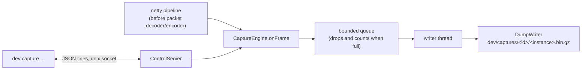

# Packet capture (`dev capture`)

Record, inspect and export the packets of the running dev network. Part of the [dev environment](dev-environment.md).

- [Quick start](#quick-start)
- [Commands](#commands)
- [Recording options](#recording-options)
- [Filters](#filters)
- [Exporting](#exporting)
- [Troubleshooting](#troubleshooting)
- [How it works, and extending it](#how-it-works-and-extending-it)

`dev capture` records the packets of the running dev network, for debugging protocol-level problems: forwarding between the proxy and a backend, transfers to Limbo, plugin messages, the configuration phase. It sees the decoded frames of **both** legs of the proxy (client to proxy, and proxy to each backend) and of every backend and Limbo, which an external MITM proxy such as SniffCraft cannot. Captures are compressed (gzip), live in `dev/captures/<id>/` (gitignored, not part of profiles) and can be read back with filters, exported for other tools, or followed live.

The recorder is a separate small plugin, `devtools/capture` (`ParadisuCapture.jar`), which `dev start` installs on the proxy, Limbo and every backend. While nothing is recorded it only follows each connection's login state; recording copies frames to a queue that a background thread compresses, and when that queue fills up packets are dropped and counted instead of slowing the server. Set `[capture] enabled = false` in `dev.local.toml` to leave it out (restart the instances after changing it).


## Quick start

```bash
dev start
dev capture start                     # asks whose packets to record and when to stop
# ...join the network, do the thing you want to look at...
dev capture stop
dev capture show                      # pick the capture, optionally build a filter
dev capture export                    # pick the capture, the format and the instances
```

Without arguments on a terminal every command below asks for what it needs (a capture from a menu, a filter step by step, the export format). Each guided run prints the **equivalent command line** (`Same as: dev capture show 2026… --type play/move_* --dir cb`), so you can learn the options and script them. Passing any option of a step skips that step's questions, and `--no-input` never asks.

## Commands

| Command | What it does |
| --- | --- |
| `dev capture start [options]` | Start recording on the running instances ([options](#recording-options)). Guided when given no recording options |
| `dev capture stop [--on names]` | Stop the recordings; prints packets, size and anything dropped |
| `dev capture status` | Plugin state, active recordings and live connections of every running instance |
| `dev capture watch [--on names] [filters] [--hex N]` | Follow packets live. Guided filter when given none. Ctrl-C ends; it does not stop a recording |
| `dev capture list` | All captures: id, instances, packets, size, why it stopped |
| `dev capture show [id] [--instance a,b] [filters] [--limit N] [--hex N] [--stats]` | Print a capture's packets, or with `--stats` counts and bytes per packet type and connection |
| `dev capture packet [id [seq]] [--instance x] [--raw file] [--no-id]` | Hex dump of one packet (the `#seq` from `show`); `--raw` writes its bytes to a file, `--no-id` leaves out the packet id |
| `dev capture export [id] [--format name] [--instance a,b] [--out dir] [filters] [--opt k=v]` | Convert a capture for another tool ([formats](#exporting)). Asks for the format when `--format` is missing |
| `dev capture formats` | The export formats |
| `dev capture rm [ids...] [--yes]` | Delete captures; a multi-select menu without ids, one confirmation for all |
| `dev capture protocol [--refresh]` | Generate or show the packet name table for the current Minecraft version |
| `dev capture doctor [instances...]` | Check that capture works: see [Troubleshooting](#troubleshooting) |

A capture `id` is the full id, any unique prefix, or `latest`; without one, commands on a terminal show a menu (newest first), and `show` and `export` use `latest` when scripted.

## Recording options

`dev capture start`:

| Option | Meaning |
| --- | --- |
| `--on <instances>` | Instances to record (comma separated or repeated). Default: all running ones, with a checkbox menu when there are several |
| `--player <name\|uuid>` | Only these players (repeatable or comma separated; names are case-insensitive). Default: everyone |
| `--next-join` | Wait for the next login that matches `--player` (anyone if none given) and record only that connection, from its handshake. Existing connections are ignored |
| `--duration <time>` | Stop after this long (`30s`, `5m`, `1h`); with `--next-join` it counts from the join |
| `--packets <n>` | Stop after this many recorded packets (across the connections of one instance) |
| `--max-size <size>` | Stop after this much uncompressed data (`64M`, `2G`); default `capture.max_size` |
| `--stop-on-disconnect` | Stop once the last recorded player has disconnected (counted per instance, so on a backend server a player switching away also counts; status pings and the proxy's backend links do not) |
| `--until <type>` | Stop once a packet of this type was recorded (repeatable; see [filters](#filters) for the type syntax) |
| `--label <text>` | Appended to the capture id, to find it again |
| `--watch` | Also follow the packets live; Ctrl-C leaves the recording running |
| `--live` | Only watch: nothing is saved and the session ends when you exit |

Server list pings are never recorded. Only one recording per instance runs at a time; a live-only session (what `watch` starts when nothing is recording) steps aside for a real one, and the watch carries on with it.

## Filters

`watch`, `show` and `export` take the same filters; all given filters must match. On a terminal, leaving all of them out starts a guided builder (search-as-you-type for packet types, menus for the rest).

| Option | Matches |
| --- | --- |
| `--type <pattern>` | Packet types, repeatable or comma separated. Names are case-insensitive, `minecraft:` is optional, `*` is a wildcard, and `state/name` (`play/move_entity_pos`, `login/hello`) is exact about the connection state. A pattern that matches nothing is an error |
| `--dir sb\|cb` | Serverbound (towards the server) or clientbound |
| `--to <receiver>` | Who receives the packet: `client`, `proxy`, or an instance name such as `lobby` or `limbo`. On the proxy the backend links are told apart by port |
| `--player <name\|uuid>` | Packets of these players' connections |
| `--state <state>` | `handshake`, `status`, `login`, `configuration` or `play` |
| `--conn <n>` | One connection, by the number `dev capture status` shows and `watch` prints in its connection lines (`#6`) |

`watch` also takes `--hex <n>` and `show` takes `--hex <n>` and `--limit <n>`: they append the first n payload bytes of each packet, or stop after n packets.

## Exporting

`dev capture formats` lists the formats; files go to `dev/captures/<id>/export/<format>/` unless `--out` says otherwise, one set per instance. Filters apply, so you can export a single player or packet type.

- **`sniffcraft`** writes the binary session files SniffCraft's `--headless` mode would (`.scbin`; drag them onto a SniffCraft window). SniffCraft keeps one session per connection, so you get one file per player and leg (`<id>_proxy_backend_Steve.scbin`). Use a SniffCraft build for the same Minecraft version: it refuses other protocol numbers and stops at the first packet id it does not know. Packets of connections whose state could not be followed are skipped.
- **`flashback`** writes a Flashback replay `.zip` per connection and leg (copy it into `.minecraft/flashback/replays/`). **`replaymod`** writes a ReplayMod `.mcpr` per connection and leg (copy it into `.minecraft/replay_recordings/`). Both need a client on the same Minecraft version, and a capture that includes the player's join (start it before they connect); connections without a complete join are skipped with a note. The mods record what the client saw, so the recording player and (for Flashback) entity movement are rebuilt from the serverbound movement packets and the tracked entity positions: they are as accurate as the server's view (block breaks by the recording player are rebuilt from the chunk data, since a client predicts its own breaks and the server never sends it those particles and sounds; other client-made effects, such as place sounds, are not). Don't use filters that drop login or configuration packets with these formats. `--opt gamemode=<0-3>` sets the Flashback player's game mode, `--opt player-type=<id>` supplies ReplayMod's player entity type for captures made before it was recorded.
- **`jsonl`** writes one JSON object per packet (sequence number, connection, player, receiver, state, name, id, size, hex) for jq and scripts.

Packet names come from Mojang's data generator for the Minecraft version in `libs.versions.toml` (`dev setup` generates the table once; `dev capture protocol --refresh` redoes it). Each capture keeps a copy of the table it was recorded with, so old captures stay readable after an update; ids missing from it show as `unknown_0x..`.

## Troubleshooting

Run `dev capture doctor` first, whenever capture misbehaves or after a Minecraft, Paper, Velocity or Limbo update. For every running instance it checks that the plugin answers, that its packet table matches the current protocol, and that a probe client (logged in without a real Minecraft client) is seen by the plugin; it prints the live netty pipeline and checks that the capture handlers sit right before the packet decoder and encoder.

- *"The capture plugin is not running on X (no control socket)":* the instance was started before `[capture]` was enabled or before `dev build`; restart it with `dev restart X`.
- *"protocol hints missing/STALE":* run `dev capture protocol --refresh` and restart the instances.
- *Dropped packets:* the writer could not keep up. Raise `capture.queue_capacity`, narrow the recording (`--player`, `--max-size`), or lower `capture.gzip_level`.
- *The proxy probe fails while `dev share` is active:* the shared proxy then requires the PROXY protocol header, which the probe does not send. Stop `dev share`, or set `share.proxy_protocol = "off"`.

## How it works, and extending it



- **Plugin** (`devtools/capture`, one jar for Paper, Velocity and Limbo, no Paradisu dependencies, compiled against Limbo from `repo.loohpjames.com`): a platform-free `core/` (`CaptureEngine`, the login state follower `ProtocolSniffer`, a writer thread, `DumpWriter`), `control/ControlServer` (JSON lines on a Unix socket; its path is passed by `dev start` as `-Dparadisu.capture.socket`) and one hook per platform. Without the socket property it does nothing.
- **If an update breaks injection**, fix the isolated places: `netty/PipelineLayout.java` (handler names; Paper and Velocity), `CapturePaper.register()` (Paper's `ChannelInitializeListenerHolder`, by reflection), `CaptureVelocity.hook()` (Velocity's `ConnectionManager` initializer holders, by reflection) and `CaptureLimbo.onConnect()` (Limbo's stream wrapping). The hot path (`CaptureEngine.onFrame`) must stay allocation-light, never block and catch everything: capture must never break a connection.
- **CLI** (`dev/src/capture/`): `commands.ts` (the commands), `wizard.ts` (the prompts), `filters.ts`, `receivers.ts`, `format.ts` (dump reader/writer), `protocol.ts` (packet tables), `exporters/` (formats), `control.ts` (socket client).
- **Dump format:** `<instance>.bin.gz` in the capture folder is a gzip of a small record stream (`DumpWriter.java`, `dev/src/capture/format.ts`). Changing a record means bumping `FORMAT` in both and still reading older ones.
- **Adding an export format:** implement `Exporter` (`dev/src/capture/exporters/types.ts`) in a new file and register it in `exporters/index.ts`. The context gives you the filtered packets, the connections, the protocol table and the receiver helper; `jsonl.ts` is the smallest example. It then shows up in `dev capture formats` and in the export menu.
