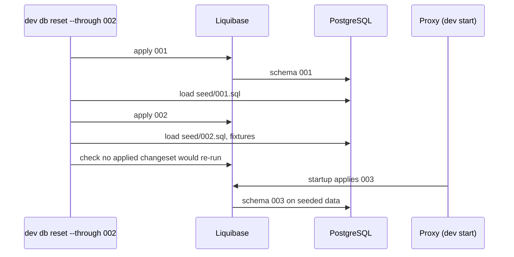

# Development environment

The devcontainer gives you a runnable network: a Velocity proxy, a Limbo waiting-room server and Paper (Purpur) backends running your working copy of the plugin, PostgreSQL 17 with sample data, and Redis for ConnectorPlugin. This page is the reference; the short version is in [CONTRIBUTING.md](../CONTRIBUTING.md#development-environment).

- [Getting started](#getting-started)
- [The `dev` command](#the-dev-command)
- [Configuring the network](#configuring-the-network)
- [Debugging and hot reload](#debugging-and-hot-reload)
- [Consoles and logs](#consoles-and-logs)
- [Database and migration testing](#database-and-migration-testing)
- [Minecraft data: fixtures, lookup and decoding](#minecraft-data-fixtures-lookup-and-decoding)
- [Troubleshooting](#troubleshooting)
- [The published image](#the-published-image)

Related pages: [sharing the network and setups](dev-sharing.md) · [packet capture](dev-capture.md) · [working on the `dev` tool](dev-tool.md).

## Getting started

1. Open the repository in VS Code and choose **Reopen in Container**. Two configurations are offered: *Paradisu (prebuilt image)* pulls the image published by CI (fast, default); *Paradisu (build locally)* builds [.devcontainer/Dockerfile](../.devcontainer/Dockerfile), which you want when editing the image.
2. Wait for `dev bootstrap` (it runs automatically as `postCreateCommand`) to build the jar, download the servers and plugins and seed the database. If it prints warnings (for example no network), fix the cause and run `dev bootstrap` again; it is safe to repeat.
3. Run `dev start`, then join `localhost:25565`. Starting the network means you accept the [Minecraft EULA](https://aka.ms/MinecraftEULA) (`accept_eula = true` in [dev/dev.toml](../dev/dev.toml)). Online mode is on by default, so use a licensed account, or set `online_mode = false` in `dev/dev.local.toml` to let any username join. [dev.local.toml.example](../dev/dev.local.toml.example) lists the common overrides.

Editor setup in the container:
- The Red Hat Java and Gradle extensions are installed in their *pre-release* channel (`@prerelease` in `devcontainer.json`) because Lombok support needs it. Outside the container, switch to the pre-release versions yourself.
- The PostgreSQL extension has two ready-made connections, `Paradisu Dev` and `LuckPerms Dev` ([.vscode/settings.json](../.vscode/settings.json)). They use "No Password" with SSL off: the dev database trusts the compose network (`.devcontainer/postgres/pg_hba.conf`, port not published). Delete duplicates you created earlier in your *User* settings.

## The `dev` command

Run `dev` for a menu, a group name (`dev db`, `dev capture`, `dev share`, `dev mc`, `dev profile`, `dev web`) for that group's menu, `dev help` for all commands by section, `dev help <group>` or `dev help <command>` (also `dev <command> --help`) for options.

- **Prompting:** missing arguments are asked for on a terminal (instance, changelog, snapshot, player, capture, ...). With arguments, with `--no-input`, with `CI` set, with `PARADISU_DEV_NO_INPUT=1` or without a terminal, `dev` never prompts.
- **Destructive commands** (`db reset`, `db seed`, `db restore`, `capture rm`, `profile import`) take `--yes`; without a terminal and without it they refuse instead of waiting.
- **Colors** switch off for pipes, `NO_COLOR` and `TERM=dumb`.

### Network

| Command | What it does |
| --- | --- |
| `dev bootstrap` | Install, build, download and seed (runs on container creation) |
| `dev setup [--refresh]` | Resolve versions and download Purpur, Velocity, Limbo and plugins into `dev/.cache` |
| `dev build` | Build the plugin jar and the capture jar (`./gradlew -q shadowJar :devtools:capture:jar`) |
| `dev start [names] [--no-build] [--ui]` | Build, deploy to every instance, apply preset configs and run them under the console supervisor. Prints `Ready. Join at ...` when done |
| `dev stop [names]` | Send `stop`/`shutdown`; the JVM is killed after 60 s |
| `dev restart [names] [--no-build]` | Stop, rebuild and start |
| `dev status` | Running state, pids and ports |
| `dev console <name> [--read-only] [--wait]` | Attach to a console; Ctrl-C detaches and the server keeps running |
| `dev console <name> --send <line> [--timeout s]` | Run one console command without a terminal and print its output (default 3 s) |
| `dev logs <name> [-f] [--console]` | The last lines of the server's log (`-f` follows; `--console`: the raw console output) |
| `dev reset-world <name>` | Delete a stopped Paper server's worlds |
| `dev clean [--all]` | Delete runtime data (`--all` also deletes `dev/.cache`) |

### Consoles

| Command | What it does |
| --- | --- |
| `dev ui [layout\|kill] [--background]` | Open the zellij workspace of live consoles |
| `dev web start\|stop\|status` / `dev web token [--read-only]` | Serve that workspace to a browser ([details](dev-sharing.md#browser-access-to-the-consoles-dev-web)) |

### Database

| Command | What it does |
| --- | --- |
| `dev db reset [--through 00N] [--all] [--no-fixtures] [--yes]` | Rebuild the database up to a changelog with seed data and fixtures (`--all` also resets LuckPerms) |
| `dev db seed [--yes]` | Reseed at the current changelog position |
| `dev db snapshot <name>` / `dev db restore <name> [--yes]` | Save and restore the database |
| `dev db fixtures [load\|list] [files] [--replace]` | Load Minecraft data fixtures (inventories) |
| `dev db psql [args]` | Run psql against the dev database |

### Minecraft data

| Command | What it does |
| --- | --- |
| `dev mc players [search] [--online]` | List players with their snapshot counts |
| `dev mc inventory <player> [--context c] [--index n] [--all] [--format f]` | Show a stored inventory decoded |
| `dev mc dump [--player p] [--context c] [--out file] [--raw]` | Write stored inventories as a fixture file |
| `dev mc nbt <source> [--path p] [--format f] [--chunk x,z] [--compact]` | Decode NBT from a file, chunk, playerdata or level |
| `dev mc item <data> [--format f] [--compact]` | Decode an item blob (base64, hex, `@file`, `-`) |
| `dev mc encode <snbt> [--array] [--hex]` | Encode SNBT as an item blob |
| `dev mc uuid <name\|uuid> [--offline]` | Convert UUID forms and look the player up |
| `dev mc columns` | List the database columns that hold Minecraft blobs |

### Other groups

| Command | See |
| --- | --- |
| `dev share start\|stop\|status\|logs\|providers` | [Sharing](dev-sharing.md#public-tunnels-dev-share) |
| `dev capture start\|stop\|status\|watch\|list\|show\|packet\|export\|formats\|rm\|protocol\|doctor` | [Packet capture](dev-capture.md) |
| `dev profile export\|import\|inspect\|list`, `dev override <instance> <path>` | [Profiles](dev-sharing.md#sharing-a-setup-profiles) |

## Configuring the network

The network is defined in [dev/dev.toml](../dev/dev.toml). Override anything in the gitignored `dev/dev.local.toml`: tables merge, and `[[servers]]` / `[[plugins]]` entries merge by `name` / `key`. The Minecraft and Velocity versions default to `auto` and follow `gradle/libs.versions.toml`, so bumping `paper-api` updates the dev network too. Backends run Purpur (a Paper fork, as in production) at the newest build for that Minecraft version.

| Table | Controls |
| --- | --- |
| `[jvm]` | `enhanced_redefinition`, `hotswap_agent`, `hotswap_plugins`, `extra_flags` |
| `[proxy]`, `[limbo]` | Ports (proxy 25565, debug 5005; Limbo 30000, debug 5008) |
| `[[servers]]` | Paper backends: `lobby` (30066, debug 5006) and `creative` (30067, debug 5007) are enabled by default |
| `[[plugins]]` | Downloaded plugins (ConnectorPlugin, LimboTransfer, LuckPerms, FAWE, WorldGuard, BKCommonLib, TrainCarts, TC Coasters, CarbonChat) |
| `[ui]`, `[web]` | zellij layout/session; web console port and bind |
| `[share]` | Tunnel provider, targets, renewal, PROXY protocol |
| `[capture]` | Packet capture plugin: `enabled`, `gzip_level`, `max_size`, `queue_capacity` |

- **Add a backend server:** add a `[[servers]]` entry (unique ports) with `enabled = true` and, to attach the debugger, a matching configuration in `.vscode/launch.json`. Servers share the proxy, database and Redis; `context` sets the session, warp and inventory contexts.
- **Add a plugin:** add a `[[plugins]]` entry with `source = "modrinth"` (and `slug`), `"url"`, `"jenkins"` (`job_url` of a Jenkins job; its latest successful build is used, `artifact_pattern` picks the jar), `"github"` (`repo = "owner/name"`; the latest release's jar, `asset_pattern` picks the asset; set `GITHUB_TOKEN` to avoid the anonymous API rate limit) or `"local"`. `platforms` may include `"limbo"` for plugins that run on the Limbo server. Modrinth plugins are resolved for the current game version; use `allow_prerelease` or `game_version_fallback` when only betas or older tags exist.
- **Preset a plugin's config:** put files in `dev/templates/plugins/<key>/<paper|velocity>/`. They are copied into the plugin's data folder (`config_dir` in `dev.toml` when the folder name differs from the key) on every start, overwriting what is there. `${NAME}` placeholders are filled from [templates.ts](../dev/src/templates.ts). Generate the real defaults by running the plugin once, then trim them down.
- **Limbo:** a standalone [Limbo](https://modrinth.com/mod/limbo-server) waiting-room server (`[limbo]` in `dev.toml`, enabled by default) runs next to the proxy with ConnectorPlugin and [LimboTransfer](https://github.com/Kas-tle/LimboTransfer). It is deliberately not in the proxy's server list: the Paradisu proxy config's `limbo-server` section points at it, so `/vparadisu maintenance` transfers players there. When the proxy starts, `LimboListener` has Limbo (addressed as `limbo` over ConnectorPlugin and Redis) run `transferall` back to `transfer-return-target`, so restarting the proxy with `dev restart proxy` returns players from Limbo. Limbo is built for one Minecraft version per release and starts first so it is subscribed before the proxy speaks. Set `limbo.enabled = false` if no Limbo build exists yet for the Minecraft version in use.
- **World presets:** `world_preset` is `redstone_ready` (flat: bedrock, 3 stone, 116 sandstone), `void` or `default`.

Notes:
- ConnectorPlugin and TC Coasters are not on Modrinth; they are fetched from their CI servers. Plugins that depend on each other (TrainCarts needs BKCommonLib, TC Coasters needs both) must all be listed.
- Newer Minecraft versions enable the whitelist by default (empty, so nobody can join); the `server.properties` template turns it off. Add `white-list=true` to a server's own template under `dev/templates/servers/<name>/` if you want to test it.
- Each JVM runs under a small detached supervisor (`dev _supervise`, see below), not in a terminal: closing your terminal never stops a server, and `dev console` can be attached from any number of terminals.
- Paper rewrites its generated config files, but `dev/templates` always wins on the next start. Edit the templates, not the files in `dev/run`.

## Debugging and hot reload

Use **Run and Debug**, then **Debug network** (starts the network and attaches to the proxy and lobby; **Debug all** adds the creative server). The image uses JetBrains Runtime with `-XX:+AllowEnhancedClassRedefinition` and `java.debug.settings.hotCodeReplace` is `auto`: edit a method and save, and VS Code pushes the recompiled class into the running server. Enhanced redefinition also allows adding and removing methods and fields. Resource changes (`messages_en.properties`, `plugin.yml`) need `dev restart <name>`, as does anything the debugger refuses to redefine. Set `hotswap_agent = true` to additionally enable HotswapAgent. [hotswap.ts](../dev/src/hotswap.ts) loads only the plugins the build needs (a dependency on `org.hibernate.orm` in `gradle/libs.versions.toml` enables HibernateJakarta, plus two JVM-level fixes) and none on Limbo; add more by name with `hotswap_plugins` in `[jvm]`. The attach configs in `.vscode/launch.json` need a `projectName` so the debugger knows which Gradle project to build on hot replace.

The attach configurations are `Attach: proxy` (5005), `Attach: lobby` (5006) and `Attach: creative` (5007). **Debug network** attaches to the proxy and lobby, **Debug all** adds creative; both first run the `dev: start` task, which finishes when `dev start` prints `Ready. Join at ...`.

## Consoles and logs

Every instance runs under a small detached supervisor (`dev _supervise <name>`, [supervisor.ts](../dev/src/supervisor.ts)) that owns the JVM's stdin/stdout, writes `dev/run/<name>/.dev/console.log` (the previous run is kept as `console.prev.log`; a crash leaves `exit.json` and `supervisor.log` next to it) and serves the console on a unix socket.

- `dev console <name>` attaches: it replays recent output, keeps a command history, and detaches on Ctrl-C or Ctrl-D without touching the server. Servers run with `-Dterminal.jline=false`, so there is no tab completion. `--read-only` only watches; `--wait` waits for the server and reconnects after a restart (what the zellij panes use).
- `dev console <name> --send "<command>"` runs one command without a terminal, prints what the console wrote during `--timeout` seconds (default 3, ANSI colors stripped when piped) and exits. It fails if the instance is not running or exits meanwhile. Commands that need a player sender (most gameplay commands) cannot be run this way.
- `dev logs <name>` prints the last 200 lines of `dev/run/<name>/logs/latest.log`; `--console` prints the supervisor's raw console log; `-f` follows (never exits).

`dev ui` opens a [zellij](https://zellij.dev) workspace made only of console clients, so closing or killing it (`dev ui kill`) never affects the servers. The default layout `network` has a *consoles* tab (proxy and Limbo stacked, then one pane per enabled backend), a *db* tab (psql) and a *shell* tab; `tabs` has one tab per instance. Layouts are generated from the enabled instances. Add your own as `dev/layouts.local/<name>.kdl` (gitignored; [dev/layouts/backends.kdl](../dev/layouts/backends.kdl) is an example), then `dev ui <name>`. Inside zellij, `dev ui <layout>` adds the layout as a tab. Detach with Ctrl-o d; Ctrl-q closes the workspace (the servers keep running), which is why `.vscode/settings.json` stops VS Code from taking Ctrl+Q for itself in the terminal. Set `ui.default_layout` / `ui.session` in `dev.toml`.

## Database and migration testing

Seed data lives in `dev/db/seed/<NNN>.sql`, one file per changelog, written against the schema as of that changelog (the deliberate NULLs in `002.sql` exist so that changelog 003 has something to backfill). `dev db reset` applies each changelog with Liquibase, loads its seed, and finally checks that no already-applied changeset would be re-run by the proxy.

To test a new changelog against realistic data:
1. `dev db reset --through <previous changelog>`
2. `dev start`: the proxy applies the new changelog on startup, exactly as in production.

When you add a changelog that changes data shape, add `dev/db/seed/<NNN>.sql` for the new columns or tables. Personal rows (for example your own UUID) go in the gitignored `dev/db/seed/local.sql`. Minecraft binary data (inventories) is not in the SQL seeds; see *Minecraft data* below.

## Minecraft data: fixtures, lookup and decoding

Paper stores items as NBT blobs: one item is the gzip of a named-root compound (`id`, `count`, `components`, `DataVersion`); an item array is a version byte (1), an int count, then a length-prefixed item per slot. The player inventory uses 41 slots (36 storage, 4 armor, 1 offhand), armor 4, the ender chest 27. The codecs ([dev/src/mc/](../dev/src/mc)) are covered by tests and follow `ItemStack#serializeAsBytes` / `#serializeItemsAsBytes` in paper-api.

- **Fixtures** (`dev/db/fixtures/*.toml`, private ones in the gitignored `dev/db/fixtures.local/`) describe inventories in SNBT, the syntax of `/give` (`{id:"minecraft:diamond_sword",count:1,components:{…}}`). `dev db reset` loads them after the SQL seeds (`--no-fixtures` skips them; `requires_changelog` skips a file when the reset stops before that changelog). Rows get deterministic ids, so `dev db fixtures load [files] [--replace]` can be repeated. The committed [inventories.toml](../dev/db/fixtures/inventories.toml) documents the format; players are named by seed name, uuid or `offline:Name` (the UUID an `online_mode = false` server gives that name; it creates the player row). Items are stamped with the DataVersion of the downloaded server jar (`data_version` in `dev.local.toml` overrides it); older stamps are upgraded by the server's data fixers.
- **Capture and reload:** play on the dev server, then `dev mc dump [--player p] [--raw]` writes the stored inventories as a fixture file you can load again (`--raw` keeps the exact bytes). `dev mc inventory <player> [--context c] [--all] [--format table|snbt|json|fixture|raw]` shows one decoded; `dev mc players [search]` lists players with their snapshot counts.
- **Decoding:** `dev mc nbt <file|->` decodes gzip/zlib/plain NBT, `.mca` chunks (`--chunk x,z`) and has shortcuts `playerdata:<player>@<server>` and `level:<server>` (`--path Data.LevelName`, `--format json` for jq). `dev mc item <base64|hex|@file|->` decodes a blob copied from the database (a single item or an array); `dev mc encode '<snbt>' [--array]` produces one. `dev mc uuid <name|uuid|[I;…]>` converts UUID forms (dashed, undashed, int array, most/least), computes the offline-mode UUID and looks the player up in the dev database and at Mojang (`--offline` skips the network).
- A new Minecraft blob column needs an entry in [columns.ts](../dev/src/mc/columns.ts); a new inventory-like table needs its own fixture section in `fixtures.ts`.

## Troubleshooting

- **"additional privileges requested" in the Dev Containers log:** newer Docker Compose builds through bake, which refuses the Dockerfile the devcontainer CLI generates in `/tmp`. The *build locally* configuration avoids this by building the image itself (`initializeCommand`), and the prebuilt one never builds. If you add a `build:` section to a compose service yourself, set `BUILDX_BAKE_ENTITLEMENTS_FS=0` (or `COMPOSE_BAKE=false`) in the environment VS Code was started from.
- **Gradle hangs for two minutes and fails with "The settings are not yet available":** another Gradle process was holding lock files in a shared `.gradle` directory and could not be asked to release them from inside the container. The compose file now mounts container-only volumes over `.gradle` and `build-logic/.gradle` (`gradle-project`, `gradle-build-logic`), so a Gradle daemon or Java extension on the host no longer interferes. If you ever see it again, something else is sharing the checkout; run `docker volume rm paradisu-dev_gradle-project paradisu-dev_gradle-build-logic` (with the container stopped) to reset the container's caches.
- **Gradle fails with "Cannot create directory '/workspaces/ParadisuPlugin/.gradle/…'":** the container user's UID was changed to match yours (the Dev Containers tooling does this when your UID is not 1000, as on GitHub runners) but the Gradle volume belongs to another user. New volumes are created world-writable and `dev bootstrap` repairs old ones (it needs `sudo`, which the image allows); to start over, remove `paradisu-dev_gradle-project` and `paradisu-dev_gradle-build-logic` with the container stopped.
- **"Supplied javaHome is not a valid folder: /home/<you>/.sdkman/…" (or other host paths) in the container:** the host and the container share the checkout, and a Java extension on the host wrote `.project`, `.classpath` and `.settings/` (including `org.eclipse.buildship.core.prefs` with your host `java.home`) into it; the container's Gradle import then hands that path to Gradle. `.vscode/settings.json` sets `java.import.generatesMetadataFilesAtProjectRoot` to `false` (window scope, so it overrides a `true` in your host user or machine settings), which stops both sides writing them. If they already exist, delete them (they are gitignored) with `rm -rf .project .classpath .settings */.project */.classpath */.settings`, then run **Java: Clean Java Language Server Workspace** in the container window (the language server caches the imported projects) and reload it.
- **A plugin fails with `UnsatisfiedLinkError … libX11.so.6`:** the image has no X11 libraries and a `DISPLAY` forwarded into the container (WSLg) makes the JDK try the X11 toolkit. The dev tool starts every server with `-Djava.awt.headless=true`; if you start one by hand, add it too.
- **Image build fails with `/tmp/gw/gradlew: not found` (exit code 127), or `dev`/`gradlew` say `bad interpreter` / `not found`, on Windows:** Git converted the shell scripts to CRLF line endings (`core.autocrlf=true`), so Linux looks for an interpreter named `/bin/sh\r`. [.gitattributes](../.gitattributes) now forces LF, and the Dockerfile strips the CR from `gradlew` itself, but an existing checkout keeps its CRLF files. Fix it once: commit or stash your changes, then `git rm --cached -r . && git reset --hard` (or clone again), and reopen the container. Clone into the WSL filesystem instead of `C:` if you want fast file access in the container.
- **`dev bootstrap` printed warnings:** it never fails container creation. Fix the cause (usually no network) and run it again; it is safe to repeat.
- **A server does not stop:** `dev stop` sends `stop`/`shutdown` to the console and kills the JVM after 60 seconds. Look at `dev console <name>` or `dev logs <name> --console` for what it is waiting on.
- **`dev status` says stopped but a java process is running:** the supervisor died (its crash output is in `dev/run/<name>/.dev/supervisor.log`). Kill the java process and start again. Stale pid files after a container restart are detected and cleaned automatically.
- **zellij says the socket path is too long:** set `ZELLIJ_SOCKET_DIR` to a short directory such as `/tmp/zj` (only happens with a very long `TMPDIR`).
- **Capture misbehaves:** run `dev capture doctor` ([details](dev-capture.md#troubleshooting)).
- **Sharing problems:** see [dev-sharing.md](dev-sharing.md).

## The published image

[.github/workflows/devcontainer.yml](../.github/workflows/devcontainer.yml) builds the image for amd64 and arm64, smoke-tests it, and publishes it to `ghcr.io/paradisu/paradisuplugin-devcontainer` (`latest` from the default branch, branch and commit tags, and a weekly rebuild for Debian updates). A second job builds the image from the current Dockerfile, starts the whole environment and checks bootstrap, seeding and a partial migration reset. To test an image change before it is merged, set `PARADISU_DEVCONTAINER_TAG=<branch>` in `.devcontainer/.env`. Pinned versions (JetBrains Runtime, Node, pnpm) are `ARG`s at the top of the Dockerfile; keep `PNPM_VERSION` equal to `packageManager` in `dev/package.json`.
