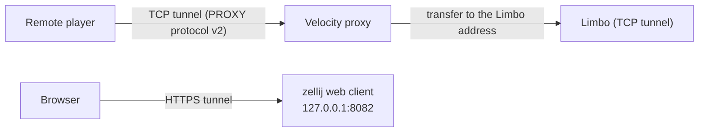

# Sharing the dev network

Let other people join your dev network and share a whole dev setup. Part of the [dev environment](dev-environment.md).

- [Joining from outside](#joining-from-outside)
- [Public tunnels (`dev share`)](#public-tunnels-dev-share)
- [Browser access to the consoles (`dev web`)](#browser-access-to-the-consoles-dev-web)
- [Sharing a setup (profiles)](#sharing-a-setup-profiles)

## Joining from outside

Compose publishes only the proxy port (`PARADISU_PROXY_PORT`, default 25565) and the Limbo port (`PARADISU_LIMBO_PORT`, default 30000) on all host interfaces, so other machines can join using the host's address. Backend and debug ports stay inside the container. Players are *transferred* to Limbo and back, so the addresses the proxy hands out must be reachable by them: set `public_host` in `dev/dev.local.toml` to your LAN or public address (default `localhost`), and `proxy.public_port` / `limbo.public_port` if you remapped a published port. On Windows with WSL2, forward the port from Windows to WSL (or use mirrored networking) and allow it through the firewall. In Codespaces or on a remote Docker host, forward port 25565 manually.

## Public tunnels (`dev share`)

| Command | What it does |
| --- | --- |
| `dev share start [proxy] [limbo] [web]` | Open tunnels for the named targets and keep them renewed (default targets: `share.targets`; a checkbox menu on a terminal). `--provider <name>` picks the tunnel service, `--foreground` runs the daemon in this terminal instead of the background |
| `dev share status` | Tunnel addresses and when they renew |
| `dev share logs [-f]` | The daemon's log (`-f` follows it) |
| `dev share stop` | Close the tunnels and restore `public_host` |
| `dev share providers` | The available tunnel services |

`dev share start` opens public tunnels, so people outside your network can join without port forwarding. The proxy and Limbo are tunnelled over TCP and the zellij web console over HTTPS (it needs the default `web.bind = "127.0.0.1"`; the tunnel provides the TLS). Limbo is included because players are *transferred* to it and back by `/vparadisu maintenance`: the addresses in the proxy's `paradisu.yml` (`limbo-server`, `transfer-return-target`) must be reachable by them. While tunnels are live, `dev share` re-renders that file with the tunnel addresses and runs `vparadisu reload` on the proxy; `dev share stop` restores `public_host`.

The default provider is [Pinggy](https://pinggy.io) through its Node SDK (an optional dependency with a native addon, downloaded on `pnpm install`). Without an account its tunnels last **60 minutes** and get random addresses, so a background daemon (`dev share logs -f` follows it) renews them about 30 seconds early (`share.renew_before_seconds`), reopens tunnels that drop, and publishes the new addresses. **Each renewal changes the address and disconnects players who joined through it.** A Pinggy token (`[share.providers.pinggy] token` in `dev.local.toml`, or `PINGGY_TOKEN`) removes the limit and keeps the address stable. Never put the token in `dev.toml`; profiles never carry `share` settings.

By default the proxy tunnel sends the PROXY protocol (`share.proxy_protocol = "v2"`) and `velocity.toml` gets `haproxy-protocol = true` while sharing, so Velocity sees the players' real addresses (and its per-IP `login-ratelimit` works per player). The catch is that Velocity then refuses connections without the header, including your own `localhost:25565`: join through the tunnel address while sharing, or set `share.proxy_protocol = "off"` (then every remote player appears as 127.0.0.1 and shares one rate limit). Limbo's tunnel never sends the header.

To add another tunnel service, see [Extension points](dev-tool.md#extension-points).

## Browser access to the consoles (`dev web`)

`dev web start` starts zellij's web client and creates the session in the background (`web_sharing "on"` in the generated config is what lets browsers attach; after changing it run `dev web stop`, `dev ui kill`, then `dev web start` since it needs a restart); open the printed URL and log in with a token (`dev web token`; `--read-only` tokens can only watch). It binds `127.0.0.1:8082` by default, which VS Code forwards from the container (`forwardPorts`). To expose it to the network set `web.bind = "0.0.0.0"` in `dev.local.toml`: zellij then requires TLS, so a self-signed certificate is generated into `dev/run/.zellij/tls` (browsers warn once), and the port must also be published in `docker-compose.yml` (a commented line is there). 

> **Warning:** anyone with a normal token has a full shell in the container. Hand out read-only tokens (`dev web token --read-only`) and keep the default bind unless you need more.

## Sharing a setup (profiles)

`dev profile export [name]` packs a working setup into `dev/profiles/<name>.tar.gz`; `dev profile import <file>` applies one. You choose what goes in (`--include`, or the checkbox prompt):

| Section | Contents | On import |
| --- | --- | --- |
| `plugins` | the exact plugin list: URL, version and SHA-256 per platform; jars that cannot be fetched again byte for byte (`url` and `local` sources) are embedded, all of them with `--embed-jars` | pins are written to `dev.local.toml`; `dev setup` re-downloads and verifies them |
| `servers` | Minecraft/Purpur/Velocity/Limbo builds and the effective server, proxy, JVM and UI setup | written to `dev.local.toml`; your `accept_eula`, `public_host` and `web` are kept |
| `overrides` | `dev/templates.local/` (see `dev override`) | replaces yours |
| `db` | `pg_dump` of the Paradisu (and LuckPerms) database | restored; refuses if it has changelogs your checkout lacks (`--force`) |
| `worlds` | world directories of the chosen (stopped) servers | replace the current worlds |

Import treats the archive as untrusted: it rejects absolute paths, `..`, links and unexpected entries, prints a review (plugin download hosts, JVM flags, first-start console commands, what will be replaced) and asks before changing anything, then backs up `dev.local.toml` and `templates.local` to `dev/.profile-backup/`. Pass `--yes` only for archives you trust. `dev profile inspect` shows a profile without applying it. Config you edited under `dev/run` is not exported unless you saved it with `dev override <instance> <path>`, which copies it into `dev/templates.local/` (same layout as `dev/templates/`, applied after it on every start).
